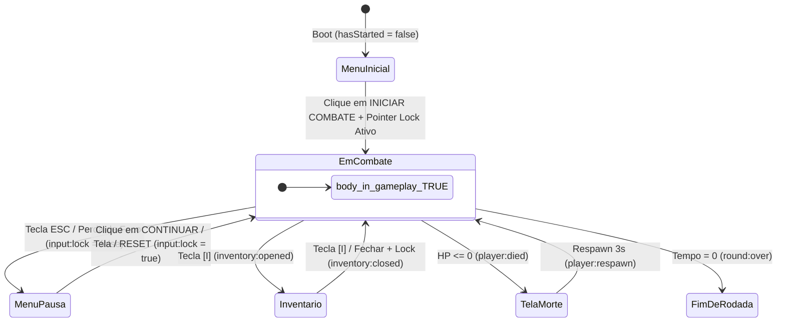

# 🖥️ Arquitetura de HUD, Responsividade & Controle de Estados de Input (`HUD.md`)

Este documento detalha o funcionamento completo da camada de interface (**HUD In-Game**, **Modais**, **Indicador Direcional de Disparos**, **Responsividade PC/Mobile** e **Máquina de Estados de Pointer Lock/Input**) do **Arena Blockout Limited**.

---

## 🧭 1. Máquina de Estados de Visibilidade (`body.in-gameplay`)

Para impedir qualquer vazamento visual entre os elementos de combate (crosshair, temporizador, K/D, HP, munição, armas, controles touch) e os menus do jogo (Menu Inicial, Pausa, Inventário Tático `[I]`, Tela de Morte e Fim de Rodada), o HUD utiliza uma máquina de estados centralizada sincronizada pela classe `body.in-gameplay`.



### Regra de Ativação (`HUD.syncGameplayUIVisibility()`)
Localizada em [`src/ui/HUD.js`](file:///c:/Users/Mateus/Desktop/Projetos/FPS%20BROWSER/deepseek/fps%20blocky/src/ui/HUD.js#L69-L74):
```javascript
syncGameplayUIVisibility() {
  const inGameplay = Boolean(
    this.isLocked &&
    !this.isInventoryOpen &&
    !this.isRoundOver &&
    !this.isDead
  );
  document.body.classList.toggle('in-gameplay', inGameplay);
}
```

### Elementos Isolados Automaticamente Fora de Combate (`body:not(.in-gameplay)`)
Definidos em [`index.html`](file:///c:/Users/Mateus/Desktop/Projetos/FPS%20BROWSER/deepseek/fps%20blocky/index.html#L40-L53):
- `#hud` (container geral de painéis de partida)
- `#crosshair` (cruz dinâmica e ponto central)
- `#crosshair-no-fire` (ícone `✕` de cano obstruído contra parede)
- `#lens` (vinheta óptica de luneta/scope)
- `#killfeed` (histórico de eliminações no topo direito)
- `#hitmarker` (marcador central de acerto/headshot)
- `#prompt` (dica contextual de interação `[F]`)
- `#kill-popup` (anúncios de Double Kill, Triple Kill, Headshot)
- `#damage-indicator` (canvas 2D de direção de disparos e dano)
- `#mobile-controls` (joystick virtual e botões táteis)

---

## 📑 2. Hierarquia de Camadas (`z-index`)

| Camada | Elemento DOM | `z-index` | Função |
| :--- | :--- | :---: | :--- |
| **Fundo 3D** | `<canvas>` WebGL | `1` | Renderização Three.js da arena e viewmodel |
| **Efeitos de Tela** | `#screen-flash` / `#suppression-overlay` | `90` – `92` | Flash vermelho de dano e vinheta de supressão balística |
| **HUD Base** | `#hud` | `100` | Container base de elementos in-game |
| **HUD Minimalista** | `.hud-minimal` (`#hp-hud`, `#weapon-hud`, `#score-hud`, `#timer-hud`) | `105` | Indicadores numéricos com flash de atividade (`hud-flash`) |
| **Radar de Disparos** | `#damage-indicator` | `108` | Canvas 2D central (`280x280px`) de arcos direcionais |
| **Combate & Mira** | `#crosshair`, `#hitmarker`, `#killfeed`, `#prompt` | `110` | Retícula dinâmica, feedback de impacto e avisos |
| **Touch Controls** | `#mobile-controls` | `115` | Zonas de toque e botões de ação mobile |
| **Tela de Morte** | `#death-screen` | `150` | Overlay de abate sofrido e contagem de respawn |
| **Inventário Tático** | `#inventory-modal` | `200` | Grid drag-and-drop de equipamentos e mochila (`[I]`) |
| **Fim de Rodada** | `#roundover-screen` | `250` | Tela final com estatísticas de abates/mortes e botão `JOGAR NOVAMENTE` |
| **Menu Principal / Pausa** | `#overlay` | `300` | Modal de configuração (Arsenal, Jogo, Mira, Texturas) |
| **Tela de Boot** | `#loading-screen` | `9999` | Barra de progresso de inicialização de assets |

---

## 🎯 3. Indicador Direcional de Disparos (`#damage-indicator`)

**Arquivos:** [`src/ui/HUD.js`](file:///c:/Users/Mateus/Desktop/Projetos/FPS%20BROWSER/deepseek/fps%20blocky/src/ui/HUD.js#L106-L137), [`src/weapons/ProjectileManager.js`](file:///c:/Users/Mateus/Desktop/Projetos/FPS%20BROWSER/deepseek/fps%20blocky/src/weapons/ProjectileManager.js#L429-L433), [`src/entities/Player.js`](file:///c:/Users/Mateus/Desktop/Projetos/FPS%20BROWSER/deepseek/fps%20blocky/src/entities/Player.js#L266-L278)

O radar direcional no centro da tela opera em **duas camadas de ameaça** para garantir leitura tática imediata mesmo quando os bots erram o primeiro disparo:

1. **Disparos de Supressão / Raspão (`player:suppression`)**:
   - Quando um projétil inimigo passa dentro do raio de supressão (`2.2m`) da cabeça do jogador sem atingi-lo diretamente, o `ProjectileManager` emite `{ pos, source, sourcePos, playerPos, intensity }`.
   - O HUD desenha um **arco âmbar tático** (`rgba(232, 147, 58)`, espessura `5.5px`) apontando para a origem do disparo.
2. **Acertos Diretos (`player:damaged`)**:
   - Quando o projétil atinge o jogador, `Player.takeDamage` emite `{ dmg, source, playerPos }` (mesmo se o cheat `godMode` estiver ativo).
   - O HUD desenha um **arco vermelho intenso** (`rgba(224, 87, 74)`, espessura `7.5px`) e promove qualquer marca de supressão existente naquela direção para marca de dano real.
3. **Deduplicação Angular em Rajadas (`_addDirectionalMark`)**:
   - Disparos consecutivos vindos de um cone de $\approx 23^\circ$ ($\text{dot} > 0.92$) atualizam e renovam o arco existente em vez de empilhar dezenas de arcos sobrepostos.

---

## 🔒 4. Blindagem de Input & Pointer Lock (`Input.js` + `main.js`)

**Arquivos:** [`src/core/Input.js`](file:///c:/Users/Mateus/Desktop/Projetos/FPS%20BROWSER/deepseek/fps%20blocky/src/core/Input.js), [`src/core/TouchInput.js`](file:///c:/Users/Mateus/Desktop/Projetos/FPS%20BROWSER/deepseek/fps%20blocky/src/core/TouchInput.js), [`src/main.js`](file:///c:/Users/Mateus/Desktop/Projetos/FPS%20BROWSER/deepseek/fps%20blocky/src/main.js#L206-L254)

### 4.1. Prevenção de Falso-Positivo Mobile em Notebooks Touch
Em [`TouchInput.js`](file:///c:/Users/Mateus/Desktop/Projetos/FPS%20BROWSER/deepseek/fps%20blocky/src/core/TouchInput.js#L5-L10), a flag `isMobile` exige simultaneamente suporte a eventos de toque **e** ponteiro primário grosso `(pointer: coarse)` ou User-Agent móvel. Isso impede que notebooks e monitores Windows com tela touch desativem o `requestPointerLock()` do mouse.

### 4.2. Recuperação Automática de Captura do Mouse
- **Cooldown de `ESC` do Navegador:** Quando o jogador aperta `ESC` e clica para voltar em menos de ~1.25s, navegadores baseados em Chromium podem rejeitar `requestPointerLock()` com `SecurityError`. O bloco `catch` em [`Input.requestLock()`](file:///c:/Users/Mateus/Desktop/Projetos/FPS%20BROWSER/deepseek/fps%20blocky/src/core/Input.js#L298-L322) mantém `this.locked = false` e re-emite `input:lock = false`, garantindo que o menu não suma sem capturar o mouse.
- **Clique Direto no Canvas:** Se o menu estiver oculto mas o `pointerLockElement` tiver sido perdido (ex: `Alt+Tab` ou fechamento do inventário com a tecla `I`), qualquer clique (`mousedown`) diretamente no `<canvas>` chama `this.requestLock()` automaticamente.

### 4.3. Congelamento do Modelo 3D por Trás de Menus e no Fim de Rodada
- **`Input.clearState()`**: Ao abrir o menu de pausa, abrir o inventário ou encerrar a rodada (`round:over`), todos os deltas de mouse (`dx, dy`), teclas pressionadas (`_actionsRaw`) e fila de ações (`_actionQueue`) são zerados imediatamente.
- **Guarda de Renderização (`isGameplayActive`)**: Em [`src/main.js`](file:///c:/Users/Mateus/Desktop/Projetos/FPS%20BROWSER/deepseek/fps%20blocky/src/main.js#L218-L254), `player.updateCamera(camera, dt)` e `viewmodel.applySwayFromRig(...)` só executam quando `gameManager.hasStarted && !gameManager.roundOver && input.locked && !inventorySystem.isOpen`. Quando em menu ou fim de rodada, a câmera e a arma permanecem 100% congeladas no fundo.

---

## 📱 5. Responsividade Multi-Resolução (Desktop, Tablet & Mobile Landscape)

Definida em [`index.html`](file:///c:/Users/Mateus/Desktop/Projetos/FPS%20BROWSER/deepseek/fps%20blocky/index.html#L440-L530):
- **Menu Modal Adaptativo (`#overlay .box`)**:
  - `width: min(650px, 94vw)` e `max-height: calc(100dvh - 24px)` com scroll interno suave (`overflow-y: auto`), garantindo que os botões `INICIAR COMBATE`, `CONTINUAR` e `RESET` nunca sejam cortados em telas baixas (`768p`, laptops compactos ou celulares na horizontal).
- **Layout Desimpedido de Botões Touch Mobile**:
  - Os botões de ação (`#btn-fire`, `#btn-ads`, `#btn-jump`, `#btn-crouch`, `#btn-reload`, `#btn-swap`, `#btn-lean-l`, `#btn-lean-r`, `#btn-smoke`, `#btn-perspective`, `#btn-interact`) foram distribuídos em coordenadas sem colisão e posicionados acima da faixa inferior do `#weapon-hud`, respeitando `env(safe-area-inset-*)`.
