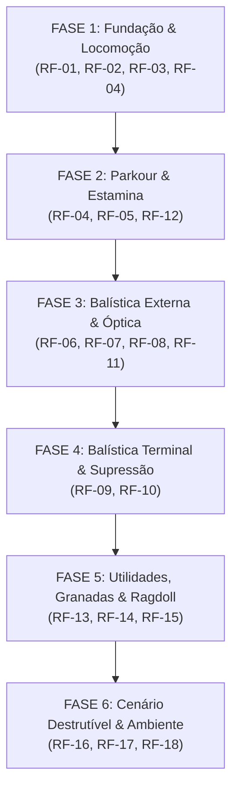

# 🏛️ ESPECIFICAÇÃO DE ENGENHARIA DE REQUISITOS: REMIX TÁTICO GODOT 4.X
## Bíblia de Transcrição, Pontos de Função e Síntese dos 4 Projetos de Referência

> **STATUS:** DOCUMENTO MESTRE DE ENGENHARIA (GROUND TRUTH PARA GODOT 4.X)  
> **APLICAÇÃO:** OBRIGATÓRIA PARA AGENTES DE IA E DESENVOLVEDORES  
> **VERSÃO ALVO:** Godot Engine 4.3+ (GDScript 2.0 / Forward+ / Mobile / Jolt Physics)  

---

## 🚫 DIRETIVA INVIOLÁVEL DE PROTEÇÃO DE TOKENS (LEIA ANTES DE ESCREVER CÓDIGO)

> [!CAUTION]
> **PROIBIDO GERAR OU MODELAR ASSETS 3D, MALHAS OU VÉRTICES EM CÓDIGO!**  
> Em projetos web anteriores (*Three.js*), agentes de IA consumiram centenas de milhares de tokens desnecessários escrevendo arquivos 3D dentro do código (`BoxGeometry`, arrays de normais, listas de vértices, coordenadas trigonométricas).  
> **Na Godot 4.x, essa prática é terminantemente proibida:**
> 1. **Modelos 3D e Armas:** Devem vir de arquivos `.gltf`, `.glb` ou pacotes modulares (Kenney, Synty, Mixamo). A IA **nunca** constrói modelos em código.
> 2. **Esqueletos e Ragdoll:** O Godot possui o nó nativo `PhysicalBone3D`. A IA **nunca** escreve sistemas de física de ossos do zero.
> 3. **Decalques:** Use o nó nativo `Decal3D`.
> 4. **O papel da IA é 100% focado em:** **Lógica de Sistemas, Fórmulas Matemáticas, Máquinas de Estado (FSM), Rigs de Câmera, Balística e Shaders pontuais em GDScript/GLSL**.

---

## 🧬 MATRIZ DE ORIGEM DOS 4 PROJETOS REMIXADOS

O projeto Godot unificará as maiores qualidades de cada um dos 4 pilares:

```
┌────────────────────────────────────────────────────────────────────────────────────────┐
│                                   OS 4 PILARES DO REMIX                                │
├──────────────────────────┬─────────────────────────────────────────────────────────────┤
│ 1. Arena Blockout        │ • Física determinística em 120Hz (fixedUpdate -> _physics)   │
│    (fps blocky - AGY)    │ • Balística CCD contínua (anti-tunneling) com 9 armas reais │
│                          │ • Ricochete angular, Wallbang e Supressão tática            │
│                          │ • Ritmo arcade ágil, responsivo, sem lentidão desnecessária │
├──────────────────────────┼─────────────────────────────────────────────────────────────┤
│ 2. Vanguard Mil-Sim      │ • Modelo de arrasto aerodinâmico G1 transônico (Mach curve) │
│    (AI Studio / Rust)    │ • Cálculo analítico de Zeroing (altura da luneta sobre cano)│
│                          │ • Desvio de vento cruzado de Didion & Tabela DOPE           │
│                          │ • Estamina pulmonar (Hold Breath) com desaceleração de sway │
│                          │ • Atraso acústico da velocidade do som (343 m/s em impactos)│
│                          │ • Alvos de aço AR500 pendulares e muros com colapso voxel   │
├──────────────────────────┼─────────────────────────────────────────────────────────────┤
│ 3. Claude of Duty        │ • Shader de Red Dot Colimado Real (paralaxe livre no vidro) │
│    (Original - Leonxlnx) │ • Granadas táticas com queima de pavio (Cooking) e momento  │
│                          │ • Sincronismo do passo com som e impacto físico pesado      │
│                          │ • Tecidos/Cabos dinâmicos ao vento em MultiMesh (1 draw call)│
├──────────────────────────┼─────────────────────────────────────────────────────────────┤
│ 4. Operation Blackout    │ • Molas do Viewmodel a 180Hz com sub-stepping (spring.js)   │
│    (Rushindra Sinha)     │ • Recoil com 30% permanente (obriga puxar o mouse pra baixo)│
│                          │ • Transição de ADS rápida na entrada e suave no fim         │
│                          │ • Head Bob baseado estritamente em DISTÂNCIA percorrida     │
└──────────────────────────┴─────────────────────────────────────────────────────────────┘
```

---

## 📋 ENGENHARIA DE REQUISITOS (PONTO DE FUNÇÃO POR PONTO DE FUNÇÃO)

---

### GRUPO 1: LOCOMOÇÃO, PESO DO CORPO & CÂMERA (GAME FEEL)

#### [RF-01] Tactical Camera Rig com Desacoplamento Rígido
* **Origem:** *Operation Blackout* (`CameraRig.js`) + *Claude of Duty* (`camera.js`)
* **Ponto de Função:** Camada de controle da `Camera3D` que compõe movimentos aditivamente para evitar que o passo, o recuo e o tremor concorram entre si.
* **Ordem de Composição Aditiva Obrigatória:**
  $$\text{Rotation} = \text{Aim}(\text{Yaw}, \text{Pitch}) + \text{RecoilSpring} + \text{LandingDip} + \text{BobAngular} + \text{TraumaShake}$$
  $$\text{Roll} = \text{StrafeRoll} + \text{LeanRoll} + \text{BobRoll} + \text{ShakeRoll}$$
* **Implementação GDScript (`res://scripts/player/TacticalCameraRig.gd`):**
```gdscript
class_name TacticalCameraRig
extends Node3D

@export var camera: Camera3D
@export var base_fov: float = 75.0

var aim_yaw: float = 0.0
var aim_pitch: float = 0.0

var recoil_offset: Vector2 = Vector2.ZERO # x: pitch, y: yaw
var landing_dip: float = 0.0
var landing_vel: float = 0.0

var bob_pitch: float = 0.0
var bob_yaw: float = 0.0
var bob_roll: float = 0.0

var lean_roll: float = 0.0
var trauma_shake_rot: Vector3 = Vector3.ZERO

func update_camera_transform(delta: float) -> void:
	# Amortecimento do afundamento de aterrissagem (Landing Dip)
	var dip_accel: float = -180.0 * landing_dip - 22.0 * landing_vel
	landing_vel += dip_accel * delta
	landing_dip += landing_vel * delta

	# Composição estrita sem conflito
	var final_pitch: float = aim_pitch + recoil_offset.x + bob_pitch + trauma_shake_rot.x - (landing_dip * 0.15)
	var final_yaw: float = aim_yaw + recoil_offset.y + bob_yaw + trauma_shake_rot.y
	var final_roll: float = lean_roll + bob_roll + trauma_shake_rot.z

	camera.rotation.x = clampf(final_pitch, -deg_to_rad(85), deg_to_rad(85))
	camera.rotation.y = final_yaw
	camera.rotation.z = final_roll
	camera.position.y = -landing_dip
```
* **Critério de Aceite:** O tremor de explosão ou impacto não pode cancelar a mira do mouse nem causar rotações descompassadas.

---

#### [RF-02] Recoil Spring-Damper com 30% de Desvio Permanente
* **Origem:** *Operation Blackout* (`spring.js` / `CameraRig.js`)
* **Ponto de Função:** O coice da arma gera uma aceleração elástica transitória, mas 30% do impacto é convertido em deslocamento angular permanente no corpo do jogador, forçando o controle de spray manual.
* **Fórmula:**
  $$\text{permanente} = \text{kick} \cdot 0.30 \quad (\text{aplica em } \text{aim\_pitch})$$
  $$\text{transitório} = \text{kick} \cdot 0.70 \quad (\text{aplica na mola de recuo})$$
* **Implementação GDScript:**
```gdscript
func apply_recoil_kick(pitch_kick: float, yaw_kick: float, permanence: float = 0.30) -> void:
	# 30% altera a mira definitiva (o jogador deve puxar o mouse para baixo)
	aim_pitch += pitch_kick * permanence
	aim_yaw += (randf() - 0.48) * yaw_kick * permanence
	
	# 70% vira o punch visual elástico da mola
	recoil_vel.x += pitch_kick * (1.0 - permanence) * 45.0
	recoil_vel.y += (randf() - 0.48) * yaw_kick * (1.0 - permanence) * 35.0
```
* **Critério de Aceite:** Tiros automáticos sustentados fazem o cano subir gradualmente, exigindo compensação ativa do jogador.

---

#### [RF-03] Sincronismo Físico de Passos & Bobbing por Distância
* **Origem:** *Claude of Duty* (`foley.js`) + *Operation Blackout* (`CameraRig.js`)
* **Ponto de Função:** O balanço da cabeça e o som dos passos são atrelados rigorosamente aos **metros percorridos**, nunca ao relógio.
* **Fórmula:**
  $$\Delta \text{dist} = \|\vec{v}_{\text{horizontal}}\| \cdot \Delta t$$
  $$\text{bob\_phase} += \Delta \text{dist} \cdot 3.1415$$
* **Implementação GDScript:**
```gdscript
var distance_accumulator: float = 0.0
const STEP_DISTANCE_SPRINT: float = 1.85 # Metros por passada
const STEP_DISTANCE_WALK: float = 1.35
const STEP_DISTANCE_CROUCH: float = 0.95

func process_movement_weight(displacement: Vector3, is_grounded: bool, current_state: String) -> void:
	if not is_grounded: return
	var h_dist = Vector2(displacement.x, displacement.z).length()
	if h_dist < 0.001: return
	
	distance_accumulator += h_dist
	var step_limit = STEP_DISTANCE_WALK
	if current_state == "sprint": step_limit = STEP_DISTANCE_SPRINT
	elif current_state == "crouch": step_limit = STEP_DISTANCE_CROUCH

	if distance_accumulator >= step_limit:
		distance_accumulator -= step_limit
		trigger_footstep_sound_and_heft()
```
* **Critério de Aceite:** Parar de andar cessa o balanço no mesmo instante; andar agachado produz passos mais cadenciados e espaçados.

---

#### [RF-04] Mantle & Vaulting (Parkour Cinemático em Muretas)
* **Origem:** *Claude of Duty* (`mantle.js`)
* **Ponto de Função:** Transposição suave de muretas e obstáculos entre 0.6m e 1.45m.
* **As 3 Checagens Obrigatórias:**
  1. `ShapeCast3D` frontal: detecta parede vertical.
  2. `RayCast3D` vertical: localiza o topo exato da borda e testa inclinação (< 25°).
  3. `ShapeCast3D` destino: confirma que a cápsula do jogador cabe em pé no topo ou do outro lado (se for obstáculo estreito $\le 0.45$m, vira *Vault*).
* **Execução:** O movimento é *rooted* (duração de 0.35s usando curva Smoothstep, desativando colisão temporariamente com a quina).
* **Critério de Aceite:** O jogador consegue escalar muros e muretas sem enroscar a colisão na quina do topo.

---

#### [RF-05] Estamina Pulmonar (Sniper Hold Breath) & Oscilação Lissajous
* **Origem:** *Vanguard Mil-Sim* (`cameraRig.ts`)
* **Ponto de Função:** Simulação de respiração natural com capacidade de prender a respiração para estabilizar tiros de precisão.
* **Fórmula do Sway:**
  $$x = \sin(t \cdot 0.9) \cdot A, \quad y = \cos(t \cdot 1.8) \cdot A \cdot 1.4$$
  *Em ADS comum:* $A = 0.0012\text{ rad}$.  
  *Prendendo a respiração (`Shift`):* $A = 0.00015\text{ rad}$ (redução de 95%).  
  *Consumo de estamina:* $0.22/\text{s}$ (~4.5 segundos de capacidade). Ao zerar, perde o fôlego e o sway dobra por 2 segundos.
* **Critério de Aceite:** O jogador consegue estabilizar o retículo para disparos cirúrgicos de longa distância dentro do limite de estamina pulmonar.

---

### GRUPO 2: BALÍSTICA, GUNPLAY & ÓPTICA TÁTICA

#### [RF-06] Motor Balístico Contínuo (CCD Sweep a 120Hz)
* **Origem:** *Arena Blockout* (`ProjectileManager.js`)
* **Ponto de Função:** Disparo de projéteis físicos por varredura contínua (*Continuous Collision Detection*), garantindo que projéteis velozes (940 m/s) nunca atravessem paredes finas (*tunneling*).
* **Algoritmo:** A cada tick de física, o projétil calcula sua posição futura e faz um `intersect_ray` do ponto anterior ao próximo ponto:
```gdscript
var query = PhysicsRayQueryParameters3D.create(current_pos, next_pos)
var hit = space_state.intersect_ray(query)
if not hit.is_empty():
	resolve_ballistic_impact(hit)
```
* **Critério de Aceite:** Disparos contra chapas de 5cm de espessura colidem 100% das vezes sem varar sem colisão.

---

#### [RF-07] Modelo de Arrasto Aerodinâmico G1 Transônico (Mach Curve)
* **Origem:** *Vanguard Mil-Sim* (`ballistics.ts`)
* **Ponto de Função:** Atenuação de velocidade realista baseada na velocidade do projétil relativa ao vento e no número Mach.
* **Fórmula de Mach e Arrasto G1:**
  $$\text{Mach} = \frac{\|\vec{v}_{\text{rel}}\|}{343.0}$$
  $$C_d = \begin{cases} 
  0.16 + 0.02 \cdot M & M \le 0.7 \\
  0.174 + 0.18 \cdot (M - 0.7)^{1.8} & 0.7 < M \le 0.95 \\
  0.28 + 0.75 \cdot (M - 0.95) & 0.95 < M \le 1.05 \quad (\text{Pico Transônico}) \\
  0.355 - 0.12 \cdot (M - 1.05) & 1.05 < M \le 1.4 \\
  0.313 - 0.065 \cdot (M - 1.4) & 1.4 < M \le 2.5 \\
  0.24 - 0.015 \cdot \min(M - 2.5, 2.0) & M > 2.5
  \end{cases}$$
  $$\vec{F}_{\text{drag}} = \frac{1}{2} \cdot \rho \cdot \|\vec{v}_{\text{rel}}\|^2 \cdot A \cdot \left(\frac{C_d}{BC \cdot 0.5}\right) \cdot \left(-\frac{\vec{v}_{\text{rel}}}{\|\vec{v}_{\text{rel}}\|}\right)$$
* **Critério de Aceite:** Projéteis 5.56 NATO perdem energia de forma mais acentuada ao cruzarem a barreira de 1000m/s para 340m/s.

---

#### [RF-08] Cálculo Analítico de Zeroing (Compensação Height-over-Bore)
* **Origem:** *Vanguard Mil-Sim* (`ballistics.ts`)
* **Ponto de Função:** Determinação do ângulo exato de elevação do cano para acertar no centro da mira a qualquer distância (100m, 200m, 500m), levando em consideração a altura da luneta sobre o cano ($y = -0.065$m).
* **Fórmula Analítica Fechada:**
  $$\theta = \text{atan}\left(\frac{v^2 - \sqrt{v^4 - g \cdot (g \cdot x^2 + 2 \cdot y \cdot v^2)}}{g \cdot x}\right)$$
* **Critério de Aceite:** Mudar o zeroing para 300m e disparar em um alvo a 300m faz a bala atingir exatamente o centro do retículo, compensando a curvatura gravitacional.

---

#### [RF-09] Desvio de Vento Cruzado de Didion & Tabela DOPE
* **Origem:** *Vanguard Mil-Sim* (`ballistics.ts`)
* **Ponto de Função:** Cálculo do desvio lateral da bala causado por ventos cruzados baseado na fórmula clássica de balística externa militar.
* **Fórmula:**
  $$\text{windage} = v_{\text{crosswind}} \cdot \left(t_{\text{voo}} - \frac{x_{\text{distancia}}}{v_0}\right)$$
  $$\text{Elevation}_{\text{MIL}} = \frac{\text{Drop}_{\text{metros}}}{x_{\text{metros}}} \cdot 1000$$
* **Critério de Aceite:** Tiros a 600m com vento lateral de 5 m/s sofrem desvio horizontal calibrado conforme a tabela balística.

---

#### [RF-10] Penetração de Superfície (Wallbang) & Ricochete Angular
* **Origem:** *Arena Blockout* (`BallisticsCalculator.js`)
* **Ponto de Função:** Balas perfuram materiais mais finos que a capacidade do calibre (madeira 300mm, gesso 400mm, concreto 45mm, aço 7mm) perdendo velocidade, ou ricocheteiam em superfícies duras se o ângulo de incidência for agudo ($< 18^\circ$).
* **Fórmula de Ricochete:**
  $$\vec{v}_{\text{ricochete}} = (\vec{v} - 2(\vec{v} \cdot \vec{n})\vec{n}) \cdot 0.55$$
* **Critério de Aceite:** Tiros raspando no concreto produzem faíscas e desviam com perda de 45% de velocidade; tiros diretos em paredes finas de compensado atingem inimigos do outro lado.

---

#### [RF-11] Shader de Mira Red Dot Colimado Real (Sem Sub-Viewports)
* **Origem:** *Claude of Duty* (`optic.glsl.js`)
* **Ponto de Função:** Retículo reflexivo holográfico em shader single-pass (`.gdshader`) projetado no infinito: o ponto vermelho flutua dentro da lente alinhado ao cano, com paralaxe real e reflexo dielétrico esverdeado, sem custo de render targets secundários.
* **Código GDShader (`res://shaders/collimated_red_dot.gdshader`):**
```glsl
shader_type spatial;
render_mode blend_mix, depth_draw_opaque, unshaded;

uniform vec3 reticle_color : source_color = vec3(1.0, 0.05, 0.05);
uniform float dot_angle = 0.014;
uniform float brightness = 10.0;

varying vec3 v_world_pos;

void vertex() {
	v_world_pos = (MODEL_MATRIX * vec4(VERTEX, 1.0)).xyz;
}

void fragment() {
	vec2 c = UV * 2.0 - 1.0;
	if (length(c) > 1.0) discard;
	float mask = 1.0 - smoothstep(0.85, 1.0, length(c));

	vec3 ray = normalize(v_world_pos - CAMERA_POSITION_WORLD);
	vec3 sight_forward = normalize((MODEL_MATRIX * vec4(0.0, 0.0, -1.0, 0.0)).xyz);
	vec3 sight_right   = normalize((MODEL_MATRIX * vec4(1.0, 0.0,  0.0, 0.0)).xyz);
	vec3 sight_up      = normalize((MODEL_MATRIX * vec4(0.0, 1.0,  0.0, 0.0)).xyz);

	float ax = dot(ray, sight_right);
	float ay = dot(ray, sight_up);
	float az = max(dot(ray, sight_forward), 1e-4);
	float a = length(vec2(ax, ay) / az);

	float core = 1.0 - smoothstep(dot_angle * 0.7, dot_angle * 1.4, a);
	float glow = exp(-a / (dot_angle * 1.8)) * 0.25;
	float intensity = (core + glow) * brightness * mask;

	if (intensity < 0.005) discard;
	ALBEDO = reticle_color * intensity;
	ALPHA = clamp(intensity, 0.0, 1.0);
}
```
* **Critério de Aceite:** Mover a câmera lateralmente enquanto mira mantém o ponto vermelho cravado no alvo em profundidade, saindo da borda do vidro se o alinhamento passar do limite.

---

#### [RF-12] Molas de Viewmodel a 180Hz com Curva de ADS `easeOutExpo`
* **Origem:** *Operation Blackout* (`spring.js`)
* **Ponto de Função:** A arma é animada por um sistema de molas com amortecimento (*Spring-Damper*), conferindo inércia natural às ações de olhar e atirar.
* **Curva de ADS:**
  $$\text{easeOutExpo}(t) = 1 - 2^{-9.2 \cdot t}$$
  *Cobre a maior parte do percurso no início e assenta suavemente no olho.*
* **Critério de Aceite:** O movimento da arma tem inércia física agradável e a transição para a mira nunca parece linear ou robótica.

---

### GRUPO 3: COMBATE TÁTICO, RAGDOLL, ÁUDIO & AMBIENTE

#### [RF-13] Granada Tática com Queima de Pavio (Cooking) & Momento
* **Origem:** *Claude of Duty* (`GrenadeController.js`)
* **Ponto de Função:** FSM completa de granada (`STOWED` $\rightarrow$ `RAISING` $\rightarrow$ `CHARGING` $\rightarrow$ `THROWING`).
* **Regras de Física:**
  1. *Cooking:* O pavio de 3.0s queima enquanto o botão é mantido pressionado.
  2. *Momento Linear:* $\vec{v}_{\text{arremesso}} = \vec{v}_{\text{direção}} \cdot \text{força} + (\vec{v}_{\text{jogador}} \cdot 0.6)$. Arremessar durante sprint projeta a granada 40% mais longe.
  3. *Cancelamento:* Apertar a tecla de equipar antes do lançamento cancela e guarda a granada sem perder munição.
* **Critério de Aceite:** É possível arremessar a granada para explodir rente ao chão ou no ar ajustando o tempo de cozimento do pavio.

---

#### [RF-14] Ragdoll Físico Nativo (Zero Gasto de Tokens)
* **Origem:** *Godot 4 Native* + *Claude of Duty*
* **Ponto de Função:** Eliminação completa de código matemático manual de ragdoll. Utilização exclusiva do nó nativo `PhysicalBone3D` da Godot 4.
* **Implementação GDScript (`res://scripts/enemies/EnemyRagdoll.gd`):**
```gdscript
func trigger_ragdoll(impulse_direction: Vector3, impulse_force: float) -> void:
	# Desativa colisor de movimento e árvore de animação
	$CollisionShape3D.set_deferred("disabled", true)
	$AnimationPlayer.stop()
	
	# Inicia simulação física nativa da Godot em 1 linha
	$Armature/Skeleton3D.physical_bones_start_simulation()
	
	# Aplica impulso balístico no osso mais próximo
	var pelvis = $Armature/Skeleton3D.find_child("Physical Bone Pelvis") as PhysicalBone3D
	if pelvis:
		pelvis.apply_central_impulse(impulse_direction * impulse_force)
```
* **Critério de Aceite:** Ao morrer, o inimigo tomba fisicamente sobre escadas e caixas de forma orgânica e fluida sem consumir tokens em código de articulação.

---

#### [RF-15] Atraso Acústico da Velocidade do Som (343 m/s)
* **Origem:** *Vanguard Mil-Sim* (`audio.ts`)
* **Ponto de Função:** Disparos e impactos distantes não tocam áudio instantaneamente. O atraso sonoro respeita a constante física do ar:
  $$t_{\text{delay}} = \frac{\text{distância (metros)}}{343.0\text{ m/s}}$$
* **Implementação GDScript:**
```gdscript
func play_distant_impact_sound(stream: AudioStream, impact_pos: Vector3, listener_pos: Vector3) -> void:
	var dist: float = impact_pos.distance_to(listener_pos)
	var delay: float = minf(dist / 343.0, 3.5)
	
	if delay > 0.05:
		await get_tree().create_timer(delay).timeout
		
	var player_3d = AudioStreamPlayer3D.new()
	player_3d.stream = stream
	player_3d.global_position = impact_pos
	get_tree().current_scene.add_child(player_3d)
	player_3d.play()
```
* **Critério de Aceite:** Um tiro acertado em um alvo a 700m produz o som de impacto aproximadamente 2 segundos após a visualização da faísca.

---

#### [RF-16] Alvos Reativos de Aço (Gong AR500 Pendular)
* **Origem:** *Vanguard Mil-Sim* (`destruction.ts`)
* **Ponto de Função:** Alvo de gongo metálico suspenso por correntes com oscilação pendular amortecida em função da energia cinética recebida:
  $$\omega += \frac{E_{\text{cinética}}}{250.0}$$
  $$\alpha = -\left(\frac{g}{L}\right) \cdot \sin(\theta) - \text{damping} \cdot \omega$$
* **Critério de Aceite:** Disparos de calibres pesados (.50 BMG) fazem o alvo girar com violência, enquanto tiros de 9mm causam oscilação sutil.

---

#### [RF-17] Colapso de Muro Voxel com Gravidade Estrutural
* **Origem:** *Vanguard Mil-Sim* (`destruction.ts`)
* **Ponto de Função:** Paredes de blocos modulares (`VoxelBrick`) onde cada bloco testa se possui blocos intactos de suporte abaixo dele.
* **Lógica:** Quando blocos inferiores são destruídos por explosões ou balas perfurantes, os blocos superiores sem suporte caem cinematicamente até o solo, criando escombros dinâmicos sem sobrecarregar a física rígida.
* **Critério de Aceite:** Derrubar a base de um pilar faz a parte de cima desabar verticalmente sobre o chão.

---

#### [RF-18] Tecidos e Fios de Poste ao Vento em MultiMesh
* **Origem:** *Claude of Duty* (`ClothSystem.js`)
* **Ponto de Função:** Toldos de tendas, varais e cabos de energia balançam suavemente com o vento sem usar física de cordas. Roda inteiramente no Vertex Shader da GPU em instâncias agrupadas (`MultiMeshInstance3D`).
* **Implementação Shader (`res://shaders/cloth_wind.gdshader`):**
```glsl
shader_type spatial;
uniform float wind_speed = 2.5;
uniform float wind_strength = 0.08;

void vertex() {
	float wave = sin(TIME * wind_speed + VERTEX.x * 2.0 + VERTEX.z * 1.5);
	// Desloca vértices baseado no peso pintado no canal vermelho dos vértices (VERTEX_COLOR.r)
	VERTEX.y += wave * wind_strength * COLOR.r;
	VERTEX.x += cos(TIME * wind_speed * 0.7) * wind_strength * 0.5 * COLOR.r;
}
```
* **Critério de Aceite:** O mapa ganha dinamismo orgânico de cidade viva com impacto zero na CPU.

---

## 🗺️ ROTEIRO SEQUENCIAL DE IMPLEMENTAÇÃO (FASE POR FASE)

Qualquer agente executando esta especificação deve seguir esta ordem exata:



1. **Fase 1 (O Corpo e o Peso):** Crie a cena `Player.tscn` (`CharacterBody3D`) com o `TacticalCameraRig.gd` desacoplado, o recoil permanente de 30% e os passos sincronizados por distância percorrida.
2. **Fase 2 (Agilidade e Fôlego):** Adicione a FSM com Mantle/Vaulting (`MantleController.gd`), Slide e o sistema de estamina pulmonar para atirador.
3. **Fase 3 (Balística e Tiro):** Instancie o motor de projéteis CCD sweep com arrasto G1 dependente de Mach, zeroing analítico fechado e o shader de Red Dot colimado.
4. **Fase 4 (Terminal e Impacto):** Adicione penetração de superfícies (wallbang), ricochete angular e a supressão tática de câmera.
5. **Fase 5 (Inimigos e Granadas):** Conecte o controlador de granadas com queima de pavio, configure o `PhysicalBone3D` para ragdoll de 1 linha nos inimigos e adicione o atraso da velocidade do som (343 m/s).
6. **Fase 6 (Mundo Vivo):** Adicione os alvos reativos AR500 pendulares, os muros voxel com colapso estrutural e o shader de toldos/cabos ao vento.

---

> **✅ CONCLUSÃO DO DOCUMENTO:**  
> Este documento consolida todo o conhecimento dos 4 projetos em um formato pronto para execução passo a passo. Ele garante o equilíbrio perfeito entre o **peso e atmosfera militar realista** e a **agilidade arcade divertida e leve**, protegendo integralmente o orçamento de tokens.
