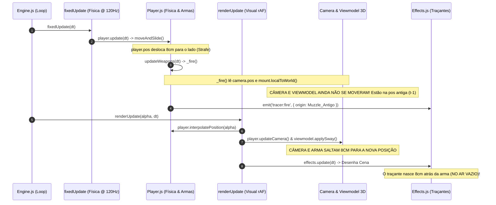

# 🛰️ RELATÓRIO TÉCNICO DEFINITIVO: SISTEMA DE TRACERS, ILUSÃO ÓTICA & BALÍSTICA
> **Documento Obrigatório para Agentes e Desenvolvedores**  
> **Status:** Arquitetura Normativa & Post-Mortem de Conflitos  
> **Escopo:** `src/fx/Effects.js`, `src/weapons/WeaponSystem.js`, `src/weapons/ProjectileManager.js`, `src/core/Engine.js`, `src/new_mechanics/BarrelCrosshairAlignment.js`

---

## 📑 Índice
1. [Visão Geral & Intenção Artística Original](#1-visão-geral--intenção-artística-original)
2. [A Saga Histórica: Por que esta feature se tornou a "Maior Pedra no Sapato"?](#2-a-saga-histórica-por-que-esta-feature-se-tornou-a-maior-pedra-no-sapato)
3. [Anatomia Técnica das Falhas Recorrentes](#3-anatomia-técnica-das-falhas-recorrentes)
   - [3.1 O Efeito "Chicote / Curva / Elástico" em Rotação Rápida de Mouse](#31-o-efeito-chicote--curva--elástico-em-rotação-rápida-de-mouse)
   - [3.2 O Efeito "Tiro Saindo do Ar" no Strafe Lateral (Descompasso de 1 Frame)](#32-o-efeito-tiro-saindo-do-ar-no-strafe-lateral-descompasso-de-1-frame)
   - [3.3 O Conflito com o Novo Sistema de HUD e Mira (f0f27a9)](#33-o-conflito-com-o-novo-sistema-de-hud-e-mira-f0f27a9)
4. [Princípios e Invariantes Arquiteturais Invioláveis](#4-princípios-e-invariantes-arquiteturais-invioláveis)
5. [Plano de Engenharia para Solução Limpa e Permanente](#5-plano-de-engenharia-para-solução-limpa-e-permanente)

---

## 1. Visão Geral & Intenção Artística Original

Na maioria dos jogos arcade ou web antigos, traçantes de tiros são linhas retas instantâneas (raios laser) ou pequenas esferas/cilindros que voam devagar. No **FPS Blocky**, a visão de design foi ambiciosa e sofisticada:

1. **Simulação de Obturador Fotográfico e Persistência Retinal (`photographic` style):**
   - Em câmeras e na retina humana, uma bala supersônica a 700–900 m/s não é vista como um objeto viajando quadro a quadro; ela cria um traço luminoso contínuo por efeito de exposição ótica ($\text{comprimento} = \text{velocidade} \times \text{tempo de exposição}$).
   - Quando atinge um obstáculo, o olho mantém a persistência retinal ($\text{persistenceTime}$) por frações de segundo.
2. **Camadas Concêntricas (Core + Glow com PSF):**
   - Um filamento central hiper-brilhante branco incandescente (`coreMesh`, com raio fino) envolvido por um envelope térmico de cor espectral (`glowMesh`, com raio volumétrico e blending aditivo), simulando a Função de Espalhamento de Ponto (Point Spread Function) de lentes óticas.
3. **Ring Buffer N=8 de Histórico:**
   - Amostragem temporal contínua da cabeça da bala para que a cauda do traçante reconstrua o histórico de voo de forma suave.
4. **Perfis Data-Driven por Munição (`ammo.json`):**
   - Múltiplos estilos distintos: `photographic` (AR-15, UZI), `laser` (M249, Prototype, SW500), `streak` (AK-47, VSS), `swipe` (P9) e `parabola` (Shotgun M12).

---

## 2. A Saga Histórica: Por que esta feature se tornou a "Maior Pedra no Sapato"?

O histórico do Git revela um ciclo vicioso de correções parciais, regressões e tentativas de mascarar o problema:

| Commit | Mensagem / Ação | O que tentou fazer | Efeito Colateral Inesperado |
| :--- | :--- | :--- | :--- |
| **`d39e680`** | `feat(tracers): implement muzzle-pin technique` | Ancorou a cauda do traçante ao bocal (`spawnOrigin`) para evitar que a bala subsônica nascesse solta no ar durante sway. | Em strafe lateral, o `spawnOrigin` estático ficava para trás no ar enquanto a arma se movia. |
| **`4fa4dd4`** | `fix(fx): dynamic distance fade-in and motion cull` | Removeu o muzzle-pinning e forçou geometria 100% reta balística (`tailX = headX - dir.x * len`). Adicionou near-cull durante movimento. | O traçante foi considerado "desconectado visualmente" da arma quando o jogador estava parado ou em baixa velocidade. |
| **`4b4693b`** | `revert: restaurar codigo para a versao d39e680` | Reverteu o código de volta para o `d39e680` na tentativa de restaurar a ancoragem visual da boca da arma. | Reintroduziu os problemas de descolamento no strafe. |
| **`a995ecc`** | `feat(fx): CS2-style FlashTracers with dynamic muzzle tracking` | Criou o `originTracker` dinâmico em `Effects.js`, forçando `t.origin` a ser atualizado **a cada frame** com a posição física do cano do viewmodel. | **A gênese do traçante elástico:** ao virar o mouse rápido, a cauda segue a arma virando e a cabeça segue a rota antiga, entortando o tiro como uma banana. |
| **`b55b4e7`** | `feat(core): Fase 17 - Muzzle Flash Data-Driven e Mascaramento` | Notou o estiramento elástico, mas tentou **mascarar visualmente** criando um flash gigante na tela e adicionando `maskElasticOffset` na cauda do traçante. | Não resolveu a raiz física: o traçante continuou amarrado à arma em movimento. |
| **`f0f27a9`** | `feat(ui,mechanics): overhaul HUD, crosshair, barrel alignment` | Introduziu o `BarrelCrosshairAlignment` e forçou o vetor balístico `_dir` no `WeaponSystem._fire()` a adotar a orientação do viewmodel em sway. | **Explosão do bug:** o vetor do tiro passou a herdar o lag de sway do viewmodel, e o `originTracker` continuou puxando a cauda, tornando as curvas e desconexões extremamente violentas. |

---

## 3. Anatomia Técnica das Falhas Recorrentes

### 3.1 O Efeito "Chicote / Curva / Elástico" em Rotação Rápida de Mouse

#### O Código Culpado em `src/fx/Effects.js`:
```javascript
// Linhas 874-878 de Effects.js
if (t.originTracker && p.trackOrigin !== false && t.life > 0) {
  t.originTracker(t.origin); // <-- SOBRESCREVE t.origin COM A POSIÇÃO AO VIVO DA ARMA
}
```
E na geometria do traçante fotográfico:
```javascript
// Linha 958 de Effects.js
if (t.life <= tailDepartureTime) {
  _tempTail.copy(t.origin); // <-- CAUDA PRESA NA ARMA EM MOVIMENTO
}
```

#### A Falácia Física do Referencial Não-Inercial:
1. No instante $t=0$, o jogador clica para atirar. A bala nasce na coordenada $M_0$ e se propaga na direção $\vec{D}$ a 800 m/s.
2. A cabeça do traçante viaja no mundo: $\vec{P}_{\text{head}}(t) = M_0 + \vec{D} \cdot (v \cdot t)$.
3. O jogador gira o mouse bruscamente $45^\circ$ para a direita em 50ms.
4. A câmera vira $45^\circ$. O viewmodel da arma vira $45^\circ$.
5. A função `originTracker` atualiza `t.origin` para a nova posição da arma $M(t)$ rotacionada $45^\circ$.
6. O traçante é desenhado como um cilindro conectando $\vec{P}_{\text{head}}$ (no espaço onde o tiro foi dado) até $\vec{P}_{\text{tail}} = M(t)$ (na ponta da arma que já virou).
7. **Resultado:** O vetor do traçante não aponta na direção da bala; ele aponta diagonalmente através da tela. Conforme a arma continua se movendo, o traçante gira e se deforma como um elástico esticado entre a parede e o cano da arma.

---

### 3.2 O Efeito "Tiro Saindo do Ar" no Strafe Lateral (Descompasso de 1 Frame)

O problema do strafe decorre de uma **defasagem temporal de ciclo** no loop principal do motor:



#### O Salto Abrupto de Desconexão:
Para piorar, no traçante fotográfico, no momento em que `t.life > tailDepartureTime` (após ~30ms), a cauda para bruscamente de seguir `t.origin` e salta para o vetor estático no mundo (`_tempTail.copy(t.originInitial)`). No strafe contínuo, o jogador vê a cauda da bala **desconectar em um solavanco e flutuar no ar**.

---

### 3.3 O Conflito com o Novo Sistema de HUD e Mira (`f0f27a9`)

No commit `f0f27a9`, foi adicionado o seguinte bloco no disparo:
```javascript
// src/weapons/WeaponSystem.js
if (this.barrelAlignment && !this.ads) {
  this.barrelAlignment.update(def, this.ads, 0.016, this.sprayRecoil);
  if (this.barrelAlignment.aimPointWorld) {
    _dir.copy(this.barrelAlignment.aimPointWorld).sub(_muzzleWorld).normalize();
  }
}
```

#### Os três erros críticos introduzidos aqui:
1. **Ignorou a Preferência do Usuário no HUD:**
   Mesmo que o jogador selecione `dynamicAlignment: false` (mira estática no centro), o `_fire()` continuava forçando o cálculo balístico pelo cano oscilante.
2. **Amostragem de Matriz Desatualizada em `fixedUpdate`:**
   `mount.matrixWorld` é lido dentro do `fixedUpdate`, antes de qualquer interpolação ou atualização de pose da câmera para o frame atual.
3. **Amplificação da Defasagem Angular no Flick:**
   Como o Viewmodel tem inércia de mola de sway (`swayPos`), girar o mouse faz a arma atrasar alguns graus. Ao clicar, a bala saía inclinada para trás da câmera, e logo em seguida a arma acelerava para frente, fazendo o `originTracker` distorcer o traçante com o dobro da violência visual.

---

## 4. Princípios e Invariantes Arquiteturais Invioláveis

Para que nenhum agente ou atualização futura quebre os traçantes novamente, **estas 4 regras são absolutas**:

### 🛡️ Regra 1: O Traçante Balístico é um Raio Imutável no Espaço de Mundo
Uma bala que sai do cano **não tem corda, cabo nem elástico amarrado à arma**. Uma vez disparada, a sua trajetória em coordenadas de mundo é matematicamente estática:
$$\vec{P}(t) = \vec{Origin}_0 + \vec{Dir}_0 \cdot (v \cdot t)$$
**É TERMINANTEMENTE PROIBIDO modificar `t.origin`, `t.dir` ou interpolar a cauda com base na posição da arma em frames subsequentes ($t > 0$).**

### 🛡️ Regra 2: Sincronização Cinemática Zero-Desync no Disparo
Quando `_fire()` é chamado dentro de `fixedUpdate`:
- A posição de referência da câmera e do bocal deve refletir exatamente o estado cinemático atual do jogador naquele instante (`player.pos`), eliminando o salto de 8 cm no primeiro frame de renderização.

### 🛡️ Regra 3: Máscara de Proximidade em Vez de Muzzle Tracking
A sensação de que a bala "emerge da arma" nos primeiros metros é alcançada da mesma forma que os motores de ponta da indústria (Source 2 / CS2, Unreal Engine) fazem:
- O traçante nasce na boca do cano sincronizada no instante $t=0$.
- O Muzzle Flash volumétrico (que é filho do viewmodel e dura 40-50ms) mascara os primeiros centímetros de saída.
- Nos primeiros 0.3 a 0.8 metros, a opacidade do traçante faz um fade-in ultra-rápido (1 frame). A essa velocidade (700 m/s), o projétil já está a dezenas de metros de distância no frame 2, tornando a paralaxe invisível ao olho humano.

### 🛡️ Regra 4: Preservação Integral do Sistema de HUD e Crosshair
- `CrosshairManager.js`, `HUD.js` e `AimAssistSystem.js` permanecem **100% intactos**.
- No `WeaponSystem._fire()`:
  - Se `crosshairManager.config.dynamicAlignment === true`: a bala segue o alinhamento 3D do cano projetado.
  - Se `crosshairManager.config.dynamicAlignment === false`: a bala converge estritamente para o centro da tela (onde a retícula estática do jogador está posicionada).
  - Em ambos os casos, o traçante viaja num raio 100% reto balístico.

---

## 5. Plano de Engenharia para Solução Limpa e Permanente

### Fase 1: Eliminar o `originTracker` dinâmico em `src/fx/Effects.js`
- Desativar a mutação contínua de `t.origin` em frames $t > 0$.
- Fazer a cauda e a cabeça de todos os estilos (`photographic`, `laser`, `streak`, `swipe`) calcularem suas posições estritamente ao longo do vetor fixo $\vec{Dir}_0$ a partir de $\vec{Origin}_0$.

### Fase 2: Eliminar o Descompasso de 1 Frame em `WeaponSystem._fire()`
- Garantir que `_camPos` e `_muzzleWorld` durante o disparo no `fixedUpdate` utilizem a posição física real e atualizada do jogador (`player.pos + eyeHeight`).

### Fase 3: Harmonizar `BarrelCrosshairAlignment` com as Configurações do HUD
- Condicionar a substituição de `_dir` no `_fire()` ao estado de `hud.crosshairManager.config.dynamicAlignment`.
- Se desligado, o tiro vai para a mira central sem interferência de inércia de sway; se ligado, respeita o cano com limites seguros contra discrepâncias extremas de flick.

### Fase 4: Atualização da Suíte de Testes
- Atualizar `test/tracer_test.js` para validar que o traçante permanece colinear com a trajetória balística inicial mesmo se a arma sofrer giros bruscos de $90^\circ$ no frame seguinte.
