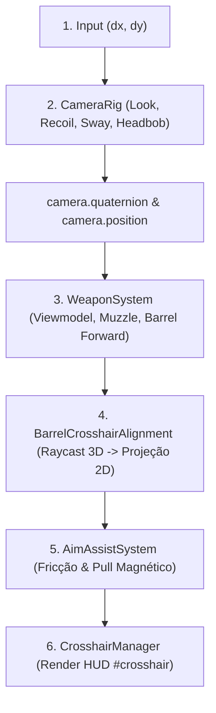
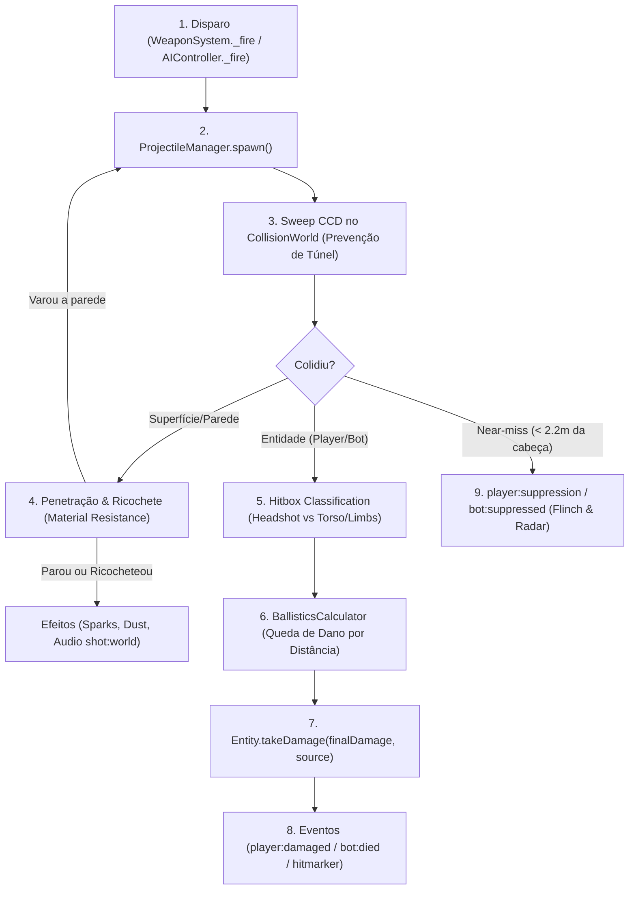

# 📐 PIPELINES — Contratos Canônicos de Mira e Dano

> **Objetivo:** Definir com autoridade técnica estrita quem manda em quê nos pipelines de **Mira** e **Dano** do **Arena Blockout: Limited**.
> Nenhuma refatoração, arma nova ou mecânica futura deve violar as ordens de execução e as fronteiras de responsabilidade descritas aqui.
> Base canônica: [`PROJECT_MAP.md`](../PROJECT_MAP.md) e [`AGENTS.md`](../AGENTS.md).

---

## 🎯 1. Pipeline de Mira (Look, Barrel & Crosshair)

### 1.1 Hierarquia de Dependência e Ordem de Execução

### 1.2 Responsabilidades Estritas por Componente

| Componente | Dono Único De | Não Pode Mexer Em |
|---|---|---|
| **`CameraRig`** | Transform da Câmera (Yaw, Pitch, Roll), Recuo angular, Headbob, Trauma de passos, Spring Arm (3ª pessoa). | Posição da crosshair no DOM; direção física do cano da arma. |
| **`WeaponSystem`** | Posição e rotação do modelo 3D da arma (`muzzleLocal`, `sightLocal`), ADS blending, Sway inercial de mouse, cálculo do ponto de saída real (`muzzleWorld`) e vetor de tiro (`getShootDirection()`). | Posicionamento da câmera de mundo; lógica de renderização CSS da mira. |
| **`BarrelCrosshairAlignment`** | Raycast do cano 3D contra o `CollisionWorld`; cálculo da convergência balística (eliminação de paralaxe em repouso); projeção matemática do ponto de impacto 3D para coordenadas normalizadas de tela. | Balística terminal; animações da arma; áudio. |
| **`AimAssistSystem`** | Bolha de fricção desacelerando mouse sens quando próximo a bots visíveis (LOS checado); atração angular suave em direção ao torso do inimigo. | Dano; recuo da arma; estado de recarga. |
| **`CrosshairManager`** | Renderização visual 2D do `#crosshair` na HUD; dynamic spread (abertura/fechamento das linhas conforme precisão); Follow Recoil visual; aviso de cano bloqueado (`#crosshair-no-fire`). | Física de projéteis; rotação 3D da arma. |

### 1.3 Regra de Ouro da Balística
> A bala física e o traçante **sempre** saem do cano 3D (`muzzleWorld`) na direção real do vetor da arma (`getShootDirection()`). O alinhamento visual do HUD adapta-se à física da arma, **nunca** o contrário.

---

## 💥 2. Pipeline de Dano (Balística, Penetração & Resolução)

### 2.1 Hierarquia de Dependência e Fluxo de Execução

### 2.2 Responsabilidades Estritas por Componente

| Componente | Dono Único De | Não Pode Mexer Em |
|---|---|---|
| **`ProjectileManager`** | Simulação temporal de projéteis com gravidade (`bulletDrop`), arrasto sônico e Continuous Collision Detection (CCD); emissão de `tracer:fire`. | Cálculo de pontuação/K-D; regras de spawn de bots. |
| **`CollisionWorld`** | Testes de intersecção física AABB e raycasts rápidos contra spatial hash grid. | Tracers visuais; cálculo de dano. |
| **Hitboxes (`TacticalManContinuous`)** | Projeção e separação volumétrica entre Cabeça (`headBox`) e Tronco/Membros (`bodyBox`). | Vida da entidade; interface do HUD. |
| **`BallisticsCalculator`** | Matrizes de dano terminal: queda de dano por distância (`damageFalloff`), penetração por material (madeira, gesso, concreto, aço), ricochete angular e dispersão. | Aplicação direta de HP em objetos; sons de impacto. |
| **Entidades (`Player` / `Bot`)** | Subtração determinística de HP (`takeDamage`), estados de morte/respawn (`alive = false`), e gatilho de cura (`player:heal`). | Modificação de stats de armas no JSON. |
