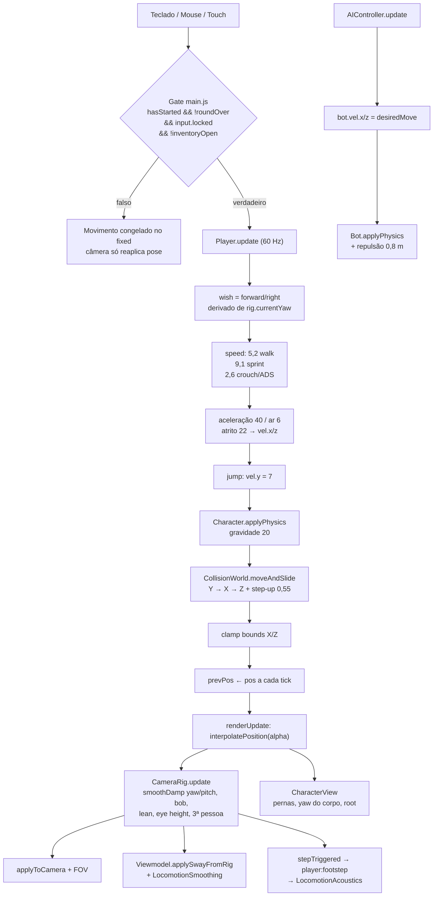

# Relatório de auditoria — Sistema de Movimentação

**Modo:** somente leitura. Nenhum arquivo foi criado, alterado ou removido. `git status --short` retornou vazio no início e no fim da análise. Nenhum CHANGELOG foi tocado porque não houve mudança de `.js`/`.json`.

**Método:** leitura direta do código-fonte JavaScript (sem usar `PROJECT_MAP.md`/`AGENTS.md` como fonte de verdade), varredura global de quem escreve em `pos`/`vel` e leitura completa da cadeia de movimentação e de seus consumidores diretos.

**Resultado da varredura global:** apenas quatro pontos escrevem posição/velocidade de personagens:
- `Player.update` (`src/entities/Player.js`)
- `AIController.update` (`src/ai/AIController.js`)
- `Character.applyPhysics` (`src/entities/Character.js`)
- repulsão anti-clipping do `GameManager` (`src/core/GameManager.js:579-588`)

---

## 1. Resumo executivo

O sistema é dividido em duas metades que rodam em taxas diferentes:

1. **Intenção + física (`fixedUpdate`, 60 Hz):** lê teclado/mouse/touch, calcula vetor de desejo, escolhe velocidade, aplica aceleração/atrito, pulo, gravidade e colisão AABB com step-up. O jogador é a única entidade com aceleração/atrito; bots recebem `vel.x/z` prontos da IA.
2. **Câmera + apresentação (`renderUpdate`, rAF):** interpola posição entre ticks, suaviza yaw/pitch com `smoothDamp`, aplica head bob, lean, agachar, recuo, shake, morte e spring-arm de 3ª pessoa; depois alimenta viewmodel, FOV, HUD e áudio de passos.

A colisão é 100% `CollisionWorld` (AABB + spatial hash de 4 m). Não há CharacterController da Three.js, raycast de malha para andar, coyote time, vault ou colisão entre corpos (bots são separados por repulsão manual).

---

## 2. Mapa de arquivos da movimentação

| Camada | Arquivo | Responsabilidade | Funções-chave |
|---|---|---|---|
| Loop | `src/core/Engine.js` | Acumulador fixo, alpha, clamp de frame, crash boundary | `startEngine` |
| Orquestração | `src/main.js` | Gate de gameplay, ordem fixed/render, FOV, câmera, viewmodel | `fixedUpdate`, `renderUpdate` |
| Entrada | `src/core/Input.js` | Bindings, estado contínuo, fila de ações, pointer lock, cheats | `pressAction`, `consumeMouseDelta`, `requestLock` |
| Entrada mobile | `src/core/TouchInput.js` | Joystick esquerdo, touchpad de câmera, botões, vibração | `_bindZones`, `_bindButtons` |
| Jogador | `src/entities/Player.js` | Intenção, velocidade, pulo, lean, agachar, limites, respawn, câmera | `update`, `updateCamera` |
| Corpo/física | `src/entities/Character.js` | `prevPos`/`renderPos`, gravidade, `applyPhysics` | `savePreviousState`, `interpolatePosition`, `applyPhysics` |
| Colisão | `src/physics/CollisionWorld.js` | AABB, spatial hash, `moveAndSlide`, step-up, raycast | `moveAndSlide`, `_tryStepUp`, `raycast` |
| Câmera | `src/core/CameraRig.js` | 4 camadas: intenção → inércia → recuo → viewmodel/scope | `addMouseInput`, `update`, `applyToCamera` |
| Locomoção da arma | `src/new_mechanics/LocomotionSmoothingSystem.js` | Pesos idle/walk/sprint/crouch/ADS, bob, inércia | `update`, `getWeaponBob` |
| Viewmodel | `src/weapons/Viewmodel.js` | Sway por velocidade angular, bob, pose, FOV | `applySwayFromRig` |
| Corpo 3D | `src/view/CharacterView.js` | Pernas procedurais, yaw do corpo, lean, pitch, root | `update` |
| IA | `src/ai/AIController.js` | Navegação, LOS, FOV, anti-stuck, tiro | `update`, `navigateTo` |
| Pathfinding | `src/ai/NavGrid.js` | Grid de 1 m, A* 8 direções, string pulling | `findPath`, `isWorldWalkable` |
| FSM dos bots | `src/ai/states/*.js` | `desiredMove` por estado | `Patrol/Engage/Search/Flee` |
| Mundo | `src/world/MapLoader.js` | Piso, `staticGeometry` → `addBox`, bounds, spawns | `loadMap` |
| Props | `src/world/ItalyProps.js` | Colisores de props | `addBox` em ~40 tipos |
| Portas | `src/world/Door.js` | Colisor dinâmico que desliga ao abrir | `toggle`, `update` |
| Drops | `src/world/ItemDrop.js` | Trigger `solid:false`, não bloqueia | construtor |
| Bots/partida | `src/core/GameManager.js` | Update dos bots, repulsão, respawn, portas | `update`, `finalizeBotRespawn` |
| Dados | `assets/config/gameplay.json`, `assets/characters/bots.json` | Velocidades, câmera, física, bot | — |
| Loader | `src/core/ConfigLoader.js` | Defaults + merge dos JSONs | `loadAll` |
| Aim assist | `src/new_mechanics/AimAssistSystem.js` | Fricção e puxão angular da câmera | `computeAssist` |
| Áudio | `src/audio/AudioSystem.js`, `src/audio/procedural/LocomotionAcoustics.js` | Síntese de passos por material | `playFootstep` |
| UI | `src/ui/MenuController.js`, `src/ui/HUD.js` | Sensibilidade/headbob/shake em runtime; bússola por yaw | sliders; `hud.update` |

---

## 3. Diagrama do fluxo

---

## 4. Pipeline detalhado

### 4.1 Loop e taxas

- `Engine` roda `fixedUpdate` em passos de **1/60 s**, com `dt` de frame limitado a **0,1 s** e no máximo **5 subpassos** (`Engine.js:86-99`). Em frame acima de ~83 ms há dilatação de tempo.
- `renderUpdate` recebe `alpha = acc / fixedDt` e o `dt` real do frame.
- `CONFIG.PHYSICS` **não é passado** para `startEngine` (`main.js:202`); os valores do JSON de física são ignorados. Vale o default `1/60`.
- O gate de gameplay (`main.js:205`) congela todo o `fixedUpdate` se a partida não começou, a rodada acabou, o pointer lock caiu ou o inventário está aberto.

### 4.2 Entrada

**Teclado (`Input.js:53-73`):**
`W/A/S/D` + setas = movimento; `Space` = pulo; `Shift` = sprint; `C` = agachar (contínuo); `Q/E` = lean; `R` = recarga/QTE; `F` = interagir; `B` = modo de tiro; `U` = granada; `I` = inventário. `ESC` não está mapeado: quem pausa é o browser liberando o pointer lock.

**Mouse:**
`mousemove` só acumula `mouse.dx/dy` quando `locked && !roundOver && !inventoryOpen` (`Input.js:405-409`). O consumo é **uma vez por tick fixo** (`Player.js:123`): se um frame tiver mais de um subpasso, o segundo recebe delta zero.

**Touch (`TouchInput.js`):**
- Detecção mobile = touch **e** (`pointer:coarse` ou UA mobile).
- Joystick esquerdo: raio 45 px, deadzone 10 px, converte em `forward/backward/left/right` booleanos; acima de 75% do raio ativa sprint.
- Touchpad direito e arrasto do botão de tiro escrevem em `input.mouse.dx/dy` com fator `2,8 × CONFIG.CAMERA.sensMultiplier`.
- ADS e agachar são toggles no mobile; pular/recarregar são hold.
- Não há normalização diagonal no joystick, mas o `_wish.normalize()` do jogador compensa.

**Câmera:** `sens = CONFIG.CAMERA.sens × sensMultiplier × (ADS ? 0,55 : 1) × scopeMul × aimAssistMult`. Default do slider de sensibilidade: **1,2 no desktop**, **2,0 no mobile** (`MenuController.js:293-299`).

### 4.3 Decisão de velocidade e aceleração (jogador)

1. `_fwd = (-sin(yaw), 0, -cos(yaw))`; `_right = (cos(yaw), 0, -sin(yaw))` usando **`rig.currentYaw`** (yaw suavizado), não o alvo do mouse (`Player.js:136-137`).
2. `sprinting = sprint && wish != 0 && !ads && !crouched` (`Player.js:146`). Observação: `crouched` ainda é o valor do tick anterior, porque só é atualizado na linha seguinte.
3. `speed`:
   - base `walkSpeed = 5,2`;
   - sprint `× 1,75 = 9,1 m/s`;
   - agachado **ou** ADS `× 0,5 = 2,6 m/s` (valor fixo no código; `adsMul: 0,42` e `crouchMul: 0,5` do JSON não são usados aqui).
4. Aceleração: interpolação exponencial para a velocidade desejada:
   - chão `k = min(40 × 1/60, 1) = 0,6667` por tick (≈95% em 3 ticks, ~50 ms);
   - ar `k = min(6 × 1/60, 1) = 0,1`;
   - sem input e no chão: atrito `k = 22/60 = 0,3667` (≈50% em 1,5 tick).
5. Pulo: `vel.y = 7`, gravidade `20` → altura máxima **1,225 m**, tempo de ar **0,7 s**. Sem coyote time e sem jump buffer. Segurar Espaço re-pula ao encostar no chão.
6. `vel.y` é zerado ao aterrissar; `vel.x/z` são zerados nos eixos bloqueados (`Character.js:62-65`).

### 4.4 Agachar, lean e morte

- `crouchAmount` interpola a 12/s entre 0 e 1. `size.y` vai de **1,8 → 1,2**; a caixa continua **0,6 × 0,6** em X/Z (o `radius: 0,35` do JSON não é usado).
- Não há verificação de teto ao levantar: a altura cresce imediatamente.
- Eye height interpola a 18/s de **1,6 → 1,05**; morto vai para **0,2** a 6/s.
- Lean: `player.lean` interpola a 14/s, e a `CameraRig` **interpola de novo** a 14/s. Efeito visual: **0,35 m** de deslocamento lateral da cabeça, **5 cm** de queda, roll de **−0,13 rad (~7,5°)**. Só a câmera se move; o corpo e a colisão não.
- Morto: alvo de `crouchAmount` vira 1,5 (`Player.js:198`), o que resulta em `size.y ≈ 0,9` (extrapolação além de 1,0), não em “altura do chão” como diz o comentário. A câmera ganha roll de morte `−0,8`.
- Respawn: 3 s controlados no `Player.update`; reposiciona no spawn, zera velocidade, reseta pitch/recuo/flinch, mas **não zera o yaw** (`CameraRig.reset` não toca em yaw).

### 4.5 Física e colisão

**Convenção:** `pos` = pés (bottom-center); `size` = extensão total.

`Character.applyPhysics` (`Character.js:49-68`):
1. `vel.y -= 20 × dt`;
2. `delta = vel × dt`;
3. `world.moveAndSlide(pos, size, delta, { stepHeight })`;
4. atualiza `onGround`, `groundMaterial`; zera velocidade bloqueada.

`CollisionWorld.moveAndSlide` (`CollisionWorld.js:155-209`):
- recupera caixas do spatial hash (célula 4 m; caixas que cobrem >64 células vão para `globalBoxes`);
- resolve **Y primeiro**, depois **X**, depois **Z**;
- no eixo X/Z, se houver sobreposição, desfaz o movimento e tenta **step-up** apenas se `onGround`;
- step-up levanta `stepHeight + 0,01`, testa sobreposição, e desce em passos de 2 cm até achar sólido;
- retorna `{ onGround, hitCeiling, hitWall, hitX, hitZ, groundMaterial }`.

**Fontes de colisor:** piso e `staticGeometry` do mapa (`MapLoader.js:167,184`), props de `ItalyProps`, portas (`Door.js:25`, sólidas só com abertura <20%), e triggers `solid:false` dos drops. `vaultable` é gravado mas **nunca lido** — não existe mecânica de vault.

**Limites do mapa:** aplicados **depois** da colisão, por clamp direto em X/Z (`Player.js:206-208`). Não há re-resolução, então o clamp pode empurrar o jogador para dentro de geometria na borda do mapa. Bots não têm esse clamp.

**Raycast:** slab method com limite de 400 m, usado por LOS dos bots, spring-arm da 3ª pessoa e aim assist. Ignora caixas `solid:false`.

### 4.6 Câmera (`CameraRig`)

Quatro camadas:

| Camada | O que faz | Detalhes |
|---|---|---|
| 0 — intenção | `targetYaw`, `targetPitch` | mouse/touch/aim assist; pitch limitado a ±1,52 rad (~87°) |
| 1 — inércia | `smoothDamp` yaw/pitch | `smoothTime` 0,016 s no hipfire; 0,024 s × peso da arma no ADS; `maxTurningRate` 50 rad/s (dividido por √peso no ADS) |
| 2 — recuo | molas de punch + coice + shake | subpassos de 2 ms; mola rotacional k=300/340, d=28/32; posição k=240, d=24; shake limitado a 1,8 |
| 1,5 — lean / 3 — bob | inclinação e passada | ver abaixo |

**Head bob (câmera):**
- só com `alive && onGround && speed > 0,15`;
- taxa de fase `max(speed × 1,75, 3)` rad/s;
- amplitude alvo `(sprint ? 0,036 : 0,026) × min(speed/walkSpeed, 1,8) × headbobScale × (ADS ? 0,1 : 1)`;
- `bobX = cos(phase) × amt × 0,70`, `bobY = sin(2×phase) × amt × 0,16`, roll `cos(phase) × amt × 0,08`;
- **`bobPitch = 0`** (horizonte não balança em pitch);
- cada cruzamento de múltiplo de π gera `stepTriggered`.

**Olhos e morte:** eye height segue agachar/morte; morte adiciona roll `−0,8`; flinch de dano decai a 15/s; recoil climb só recupera automaticamente se `GUNPLAY.autoRecoilRecovery` estiver ligado.

**3ª pessoa (`whoami`):** spring-arm de **2,4 m**, offset direito **0,45 m**, elevação **0,22 m**; colisão com `world.raycast` a partir do pivô da cabeça, distância mínima 0,35 m, suavização 20/s; blend 1ª↔3ª a 12/s. O viewmodel some quando `thirdPersonAmount ≥ 0,6`; o corpo 3D aparece quando `> 0,05`.

**Aplicação final (`applyToCamera`):** `rotation.order = 'YXZ'`; yaw = `currentYaw + flinchYaw + recoilY + shakeY`; pitch = `currentPitch + bobPitch(=0) + flinchPitch + recoilX + shakeX`; roll = `bobRoll + currentRoll + recoilZ + shakeZ + leanRoll`.

**FOV (`main.js:294-300`):** hip 78; ADS = `adsFov` da arma ou 55; sniper com luneta = 60; sprint soma `8 × sprintWeight`; interpolação de 26/s.

### 4.7 Interpolação e apresentação

- `savePreviousState` copia `pos → prevPos` no início de cada tick fixo.
- No render, `renderPos = lerp(prevPos, pos, alpha)` (`Character.js:32-34`).
- A câmera usa `renderPos`, então a suavidade visual vem da interpolação; yaw/pitch têm suavização própria.
- `CharacterView` anima pernas por `vel` (swing senoidal proporcional à velocidade), gira o corpo para a direção do movimento com limite de 1,05 rad em relação à mira, aplica lean no tronco e pitch no pescoço. Convenção: o corpo do jogador usa `yaw + π` porque yaw 0 da câmera olha para −Z.
- **Dois sistemas de bob independentes:** um na `CameraRig` (câmera) e outro no `LocomotionSmoothingSystem` (arma). As fases e frequências não são compartilhadas (8→12 Hz na arma; `speed×1,75` na câmera).

### 4.8 Locomoção da arma e FOV

`Viewmodel.applySwayFromRig` (`Viewmodel.js:249-331`):
- usa `rig.angularVelocity` (yaw/pitch + recuo) para gerar força de mola no sway;
- massa da arma modula rigidez/amortecimento (`weight / 3,5`);
- `LocomotionSmoothingSystem` produz pesos contínuos idle/walk/sprint/crouch/ADS, bob (0,009 walk / 0,018 sprint, atenuado 85% no ADS) e inércia longitudinal por aceleração;
- multiplicadores: ADS 0,18, sprint 1,25 no sway;
- `headbobScale` afeta tanto câmera quanto arma; no ADS a arma mantém 12% do sway/bob.

### 4.9 Passos e áudio

Há **dois caminhos** de passo no jogador:
1. `Player.js:212-221`: só roda se `!this.rig` — como todo `Player` tem `rig`, esse bloco é **código morto**.
2. `Player.updateCamera` (`Player.js:269-274`): caminho real. Exige `alive && onGround && speed > 0,8` e `rig.stepTriggered`, emitindo `player:footstep { pos, material }`.

Como o `stepTriggered` vem da fase da câmera:
- walk 5,2 m/s → ~0,345 s entre passos;
- sprint 9,1 m/s → ~0,197 s;
- crouch/ADS 2,6 m/s → ~0,69 s.

`AudioSystem` escuta `player:footstep` e sintetiza passo procedural por material (`metal`, `sand/dirt/grass`, `concrete/stone/brick`, default) com calcanhar, ponta do pé, ressonância e scuff. Portanto o áudio de passo roda no **render**, não no tick fixo.

---

## 5. Bots — subsistema de movimentação

- `Bot.update` (`Bot.js:48-64`) chama `AIController.update`, interpola lean e chama `applyPhysics(dt, 0,5)`.
- `AIController.update` (`AIController.js:240-283`):
  - LOS a **10 Hz** com jitter;
  - cone de visão de **110°** (`fov: 2,45 rad`) apenas em `patrol`/`search`; abaixo de 3 m a visão é 360°;
  - `engage`/`flee` não aplicam cone (LOS 360°);
  - no fim, copia `desiredMove` direto para `bot.vel.x/z` — **sem aceleração nem atrito**.
- `navigateTo` (`AIController.js:84-139`): A* com repath de 0,55–0,9 s, tolerância de waypoint 0,72 m, aproximação final 0,15 m, giro suavizado por `_faceTowards`.
- Velocidades por estado:
  - patrulha: `3,2 × 0,75 = 2,4 m/s`;
  - busca: `3,2 m/s`;
  - combate: strafe `1,92 m/s` + avanço `3,85 m/s` se >14 m, recuo `1,92 m/s` se <5 m;
  - fuga: `5,5 m/s`.
- Anti-stuck: a cada 0,35–0,45 s, se queria andar >0,6 m/s e andou <0,12 m, limpa o path, testa 5 ângulos laterais/traseiros no `NavGrid` e faz sidestep de 0,26 s.
- `NavGrid`: grid de 1 m, raio do bot 0,42 m, step 0,52 m, altura 1,65 m, cache por célula, A* 8 direções sem cortar quinas, limite de 450 iterações, string pulling e fallback pelo melhor nó.
- `GameManager` aplica repulsão player↔bot a 0,8 m, movendo **ambos** por `pos` diretamente.
- Respawn de bot: 4 s; spawn a ≥11 m do jogador, ≥3 m de props, ≥2,5 m de outros bots; arma sorteada.
- Bots usam colisão `0,8 × 1,7 × 0,8`, step 0,5, não têm clamp de bounds e podem ser deslocados pela repulsão sem passar por `moveAndSlide` naquele frame.

---

## 6. Constantes efetivas (o que realmente vale em runtime)

| Parâmetro | Valor efetivo | Fonte |
|---|---|---|
| Tick fixo | 1/60 s, até 5 subpassos, frame ≤0,1 s | `Engine.js` |
| Walk | 5,2 m/s | `gameplay.json` |
| Sprint | 9,1 m/s (×1,75) | `gameplay.json` |
| Crouch/ADS | 2,6 m/s (×0,5 hardcoded) | `Player.js:179-182` |
| Aceleração chão/ar | 40 / 6 | `gameplay.json` |
| Atrito | 22 | `gameplay.json` |
| Gravidade / pulo | 20 / 7 → 1,225 m, 0,7 s | `gameplay.json` |
| Step height | 0,55 jogador; 0,5 bot; 0,52 NavGrid | código |
| Caixa do jogador | 0,6 × 1,8 × 0,6 (agachado 1,2) | `Player.js:19,200` |
| Olhos | 1,6 / agachado 1,05 / morto 0,2 | `gameplay.json` |
| Pitch | ±1,52 rad | `gameplay.json` |
| Sensibilidade | 0,0022 × slider (1,2 desktop / 2,0 mobile) | `ConfigLoader` + UI |
| ADS | sens ×0,55; FOV 55; smooth 0,024 s | `gameplay.json` |
| Inércia angular | smooth 0,016 s; máx. 50 rad/s | `CameraRig` |
| FOV | 78 hip / 55 ADS / 60 luneta / +8 no sprint | `main.js` |
| 3ª pessoa | 2,4 m atrás, 0,45 m direita, 0,22 m acima | `CameraRig` |
| Bob câmera | 0,026 walk / 0,036 sprint × até 1,8 × escala; ADS 10% | `CameraRig` |
| Lean | 0,35 m, 5 cm, 7,5°, suavizado 2× a 14/s | `Player` + `CameraRig` |
| Passo | speed >0,8; ~0,35 s walk / ~0,20 s sprint | `CameraRig` + `Player` |
| Regeneração | 5 s de delay, 12 hp/s | `gameplay.json` |
| Respawn jogador | 3 s | `Player.js:299` |

---

## 7. Eventos relevantes

| Evento | Emissor | Consumidor | Efeito |
|---|---|---|---|
| `input:lock` | `Input` | `MenuController`, `HUD` | abre/fecha pausa, libera mouse |
| `player:footstep` | `Player.updateCamera` | `AudioSystem` | passo procedural por material |
| `player:ads` | `WeaponSystem` | `Player` | espelha ADS no jogador |
| `player:perspective_changed` | `Player` | ninguém | só informativo |
| `player:damaged` | `Player` | HUD/áudio/háptico | feedback e flinch |
| `player:died` | `Player` | `AIController` | bots passam a fugir |
| `player:respawn` / `respawn_tick` | `Player` | HUD | contagem e reset |
| `cheat:activated` | `Input` | `Player`, UI | `whoami`, `gettherefast`, `baguvix`, `professionalkiller` |
| `door:toggle` | `Door` | `NavGrid` | limpa cache de caminhabilidade |
| `weapon:fired` | `WeaponSystem` | bots, view, háptico | bots em patrulha ouvem a <35 m |
| `interact:target` | `GameManager` | `TouchInput` | mostra botão de interagir |
| `round:over` | `GameManager` | `Input` | limpa estado e libera lock |

---

## 8. Dados consumidos × dados órfãos

| Chave | Situação |
|---|---|
| `PLAYER.height/crouchHeight/eyeHeight/eyeCrouch` | usados |
| `PLAYER.walkSpeed/sprintMul/accel/airAccel/friction/jumpSpeed/gravity/stepHeight` | usados |
| `PLAYER.crouchMul` (0.5) e `adsMul` (0.42) | carregados, **ignorados** — o código usa 0,5 fixo |
| `PLAYER.radius` (0.35) | ignorado — caixa fixa de 0,6 m |
| `CAMERA.hipFov/adsFov/sens/adsSensMul/pitchLimit` | usados |
| `CAMERA.smoothTime/adsSmoothTime/maxTurningRate` | usados (defaults, pois o JSON não os define) |
| `SWAY.walkBobFrequency/sprintBobFrequency` | usados na arma |
| `SWAY.walkBobAmplitude/sprintBobAmplitude/spring*/idleBreathingSpeed` | ignorados; amplitudes e molas são hardcoded |
| `PHYSICS.*` | não passado ao `Engine` |
| `BOTS.walkSpeed/sprintSpeed/viewRange/fov/reactionTime/losMemory/searchTime/fireInterval/accuracy` | usados |
| `BOTS.damageBody/damageHead` | uso parcial (fallback de dano) |
| `ACCESSIBILITY.headbobScale/shakeScale/vibrationEnabled` | usados |
| `GUNPLAY.autoRecoilRecovery/recoilRecoverySpeed` | usados |
| `vaultable` (mapa/props) | gravado, nunca lido |

---

## 9. Achados e riscos (com evidência)

1. **Código morto de passo no tick fixo** — `Player.js:212` exige `!this.rig`, impossível para `Player`. Os passos reais saem no render (`Player.js:271`).
2. **Sprint com estado de crouch atrasado** — `sprinting` é calculado antes de `crouched` ser atualizado (`Player.js:146-147`); por um tick é possível sprintar agachado.
3. **Multiplicadores de velocidade ignoram o JSON** — `adsMul: 0.42` e `crouchMul` não são lidos; ambos usam 0,5 (`Player.js:179-182`).
4. **Clamp de bounds após a colisão** — `Player.js:206-208` pode inserir o jogador dentro de parede na borda do mapa, sem re-resolver.
5. **Levantar sob teto baixo** — `size.y` cresce sem teste de headroom (`Player.js:200`). Como `moveAndSlide` resolve Y com `pos.y = b.max.y` para qualquer sobreposição quando `delta.y <= 0` (`CollisionWorld.js:172-176`), há risco de teleporte para cima de caixa/parede.
6. **Morte extrapola `crouchAmount`** — alvo 1,5 (`Player.js:198`) produz `size.y ≈ 0,9`, contradizendo o comentário “força a altura para o chão”.
7. **Lean com suavização dupla** — `Player.js:159` e `CameraRig.js:414`; resposta final mais lenta que 14/s.
8. **Dois bobs independentes** — câmera (`CameraRig`) e arma (`LocomotionSmoothingSystem`) usam fases e frequências diferentes; podem dessincronizar visualmente.
9. **Sem coyote time / jump buffer; auto-bhop** — segurar Espaço re-pula ao aterrissar (`Player.js:162-165`).
10. **Delta de mouse consumido por tick fixo** — múltiplos subpassos no mesmo frame recebem zero no segundo (`Player.js:123`); a suavização da câmera roda no render.
11. **Respawn não zera yaw** — `rig.reset()` não mexe em `currentYaw/targetYaw` (`CameraRig.js:227-246`).
12. **Bots sem aceleração/atrito e sem bounds** — `AIController.js:281-282`, `Bot.js:58`; a repulsão do `GameManager` move `pos` diretamente.
13. **FOV de bot só em patrulha/busca** — em combate a detecção é 360° por LOS.
14. **Inconsistência de step height** — 0,55 jogador, 0,5 bot, 0,52 NavGrid.
15. **`CONFIG.PHYSICS` e várias chaves de `SWAY`/`PLAYER` são decorativas** — loader aceita, gameplay ignora.

---

## 10. Onde mexer para cada tipo de ajuste

| Objetivo | Ponto correto |
|---|---|
| Velocidade de caminhada/corrida | `assets/config/gameplay.json` → `player.walkSpeed/sprintMul` |
| Aceleração, atrito, gravidade, pulo | `gameplay.json` → `player.accel/airAccel/friction/gravity/jumpSpeed` |
| Altura de degrau | `gameplay.json` → `player.stepHeight` (jogador) e `Bot.applyPhysics`/`NavGrid` para bots |
| Sensibilidade e ads | `gameplay.json` → `camera.sens/adsSensMul` + slider em runtime |
| Head bob / shake | `CONFIG.ACCESSIBILITY` (sliders) e amplitudes em `CameraRig.js` |
| Inércia/turning rate | `CameraRig.js` (`smoothTime`, `maxTurningRate`) |
| Colisão/step-up | `CollisionWorld.moveAndSlide` / `_tryStepUp` |
| Lean | `Player.js` (entrada) + `CameraRig.js` (offset/roll) |
| 3ª pessoa | `CameraRig` (`tpDistance`, offsets, spring-arm) |
| Navegação dos bots | `NavGrid.js` + `AIController.navigateTo` |
| Velocidades dos bots | `assets/characters/bots.json` + constantes nos estados |

---

### Conclusão

O sistema é coeso e determinístico no eixo principal: **input → intenção → velocidade → aceleração/atrito → gravidade → `moveAndSlide` AABB → clamp → interpolação → câmera suavizada**. As principais fragilidades não estão na arquitetura, e sim em pontos específicos: multiplicadores de velocidade hardcoded divergindo do JSON, clamp de bounds fora da colisão, ausência de teste de teto ao levantar, código morto de passo e duplicidade de suavizações/bobs. Nenhum arquivo foi modificado.
