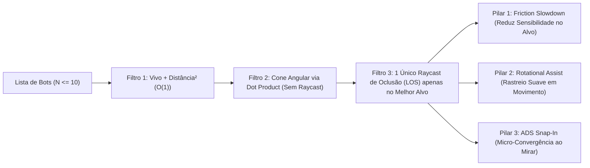

# 🎯 Plano: Sistema de Aim Assist Refinado de Alta Performance (Mobile & Acessibilidade)

## 1. Pesquisa de Referência & Arquitetura de Desempenho

Com base nos padrões de *Aim Assist* dos principais FPS modernos (*Call of Duty: Warzone*, *Apex Legends*, *Destiny 2* e *COD Mobile*), um Aim Assist refinado que **não parece artificial/travado** e possui **custo de CPU quase zero** combina **3 pilares matemáticos** sobre um pipeline de filtragem com *Early-Exit*:



### Por que é Ultra-Rápido (Zero Garbage Collection):
1. **Zero Alocações por Frame:** Todos os vetores (`THREE.Vector3`) são pré-alocados estaticamente no módulo.
2. **Descarte Angular Antes do Raycast:** Calcula o produto escalar ($\cos\theta = \hat{\mathbf{f}} \cdot \hat{\mathbf{u}}$) de todos os bots primeiro. Bots fora da "bolha magnética" ($\theta > \theta_{\text{bubble}}$) são descartados com aritmética pura.
3. **Máximo de 1 Raycast por Frame:** O `collisionWorld.raycast()` (para impedir que a mira grude através de paredes) só é executado **uma única vez por frame**, exclusivamente para o melhor candidato já dentro da bolha da mira.

### Os 3 Pilares de Refinamento:
1. **Bolha de Fricção / Slowdown (`Friction Bubble`):**
   - Raio dinâmico em espaço de mundo ($R_{\text{world}} \approx 0.95\text{m}$ ao redor do peito/cabeça do inimigo, projetado em ângulo $\theta_{\text{bubble}} = \arctan(R_{\text{world}} / d)$).
   - Atenua suavemente a sensibilidade do toque/mouse em até **48%** no centro da bolha ($w = 1 - (\theta / \theta_{\text{bubble}})^2$), impedindo que o jogador passe direto pelo alvo (*overshoot* típico de telas touch).
2. **Assistência Rotacional Magnética (`Rotational Aim Assist`):**
   - **Só atua quando há intenção ativa do jogador** (movimentando o personagem, movendo a câmera, em ADS ou atirando) — se o jogador soltar os controles, a câmera nunca gira sozinha.
   - Aplica uma rotação elástica suave em direção ao peito superior (`y + 1.20m`) com **compensação de velocidade do bot** ($\mathbf{P} + \mathbf{V}_{\text{bot}} \cdot 0.035$).
   - Possui uma **Zona Morta Interna (`Inner Deadzone` de ~0.45°)** no centro do inimigo para permitir que o jogador escolha livremente mirar na cabeça (*headshot*) ou no peito sem "brigar" contra o imã.
3. **Micro-Snap de ADS (`ADS Target Snap`):**
   - No instante em que o jogador aperta o botão de mirar (`ADS false -> true`), se houver um inimigo visível próximo ao centro ($\theta < 1.35 \cdot \theta_{\text{bubble}}$), aplica uma janela curta (`0.14s`) de convergência suave para alinhar a mira no alvo.

---

## 2. Alterações Propostas por Arquivo

### 2.1. [NEW] [`src/new_mechanics/AimAssistSystem.js`](file:///c:/Users/Mateus/Desktop/Projetos/FPS%20BROWSER/deepseek/fps%20blocky/src/new_mechanics/AimAssistSystem.js) & [`src/new_mechanics/index.js`](file:///c:/Users/Mateus/Desktop/Projetos/FPS%20BROWSER/deepseek/fps%20blocky/src/new_mechanics/index.js)
- Criar a classe modular `AimAssistSystem` dentro de `src/new_mechanics/` (com cabeçalho completo de mapeamento para o porte Godot 4.x).
- Método principal `apply(dt, { player, input, dx, dy, baseSens })`:
  - Retorna `{ dx, dy, sensMultiplier, deltaYaw, deltaPitch, hasTarget }`.
  - Quando desativado (`enabled === false` ou `'none'`), retorna imediatamente sem custo computacional.

### 2.2. [`src/ui/CrosshairManager.js`](file:///c:/Users/Mateus/Desktop/Projetos/FPS%20BROWSER/deepseek/fps%20blocky/src/ui/CrosshairManager.js)
- Adicionar em `DEFAULT_CROSSHAIR_CONFIG`:
  ```js
  aimAssist: true // true ('true' = ON) | false ('none' = OFF)
  ```
- Helper `isAimAssistEnabled()` que retorna `true` quando `this.config.aimAssist === true || this.config.aimAssist === 'true'` e `false` quando `'none'` ou `false`.

### 2.3. [`index.html`](file:///c:/Users/Mateus/Desktop/Projetos/FPS%20BROWSER/deepseek/fps%20blocky/index.html) & [`src/ui/MenuController.js`](file:///c:/Users/Mateus/Desktop/Projetos/FPS%20BROWSER/deepseek/fps%20blocky/src/ui/MenuController.js)
- Adicionar na aba **🎯 MIRA** (`data-panel="crosshair"`) o seletor com os valores solicitados (`TRUE` para ON e `NONE` para OFF):
  ```html
  <div class="menu-option">
    <label for="ch-aim-assist">Assistência de Mira (Aim Assist)</label>
    <select id="ch-aim-assist">
      <option value="true" selected>TRUE (Ativado - Magnético &amp; Mobile)</option>
      <option value="none">NONE (Desativado)</option>
    </select>
  </div>
  ```
- Conectar `#ch-aim-assist` em `MenuController._bindCrosshairUI()` para salvar e restaurar no `localStorage`.

### 2.4. [`src/entities/Player.js`](file:///c:/Users/Mateus/Desktop/Projetos/FPS%20BROWSER/deepseek/fps%20blocky/src/entities/Player.js) & [`src/main.js`](file:///c:/Users/Mateus/Desktop/Projetos/FPS%20BROWSER/deepseek/fps%20blocky/src/main.js)
- Adicionar `player.setAimAssist(aimAssistSystem)` em `Player.js`.
- No loop de look de `Player.update(dt, input)`:
  - Se `this.aimAssist` estiver acoplado e ativo, processa `(dx, dy, sens)` pelo `this.aimAssist.apply(...)`, aplicando o *Slowdown Friction* na sensibilidade e o ajuste angular suave (`deltaYaw`, `deltaPitch`) no `this.rig`.
- Instanciar `AimAssistSystem` em `src/main.js` conectando `world`, `botsProvider` e `hud.crosshairManager`.

---

## 3. Plano de Verificação

1. **Testes Unitários (`test/crosshair_manager.test.js`):**
   - Testar a opção `aimAssist` (`true` vs `'none'`) no `CrosshairManager`.
   - Testar `AimAssistSystem` diretamente validando:
     1. **Friction Slowdown:** Sensibilidade reduzida quando a mira está sobre a bolha do bot.
     2. **Rotational Pull:** Correção angular suave em direção ao bot quando o jogador se move/mira.
     3. **Occlusion Check (LOS):** O Aim Assist é **bloqueado** (`hasTarget === false`) se houver uma parede entre o jogador e o bot.
     4. **Desativado (`NONE`):** Zero interferência na sensibilidade ou rotação quando `aimAssist` é `'none'`.
2. **Suíte Completa:** Executar `npm test`.
