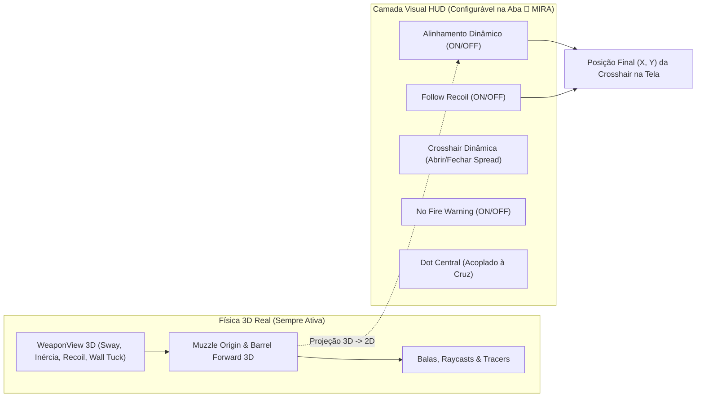

# 🎯 Walkthrough Completo: Overhaul de Miras, Balística 3D & Aim Assist Refinado

Este documento consolida todas as mecânicas implementadas no **Overhaul de Miras e Balística**, projetadas com separação estrita entre a **Física 3D Real do Cano** e a **Representação Visual no HUD**, além de documentação pronta para o porte **Godot 4.x** em [`src/new_mechanics/`](file:///c:/Users/Mateus/Desktop/Projetos/FPS%20BROWSER/deepseek/fps%20blocky/src/new_mechanics/index.js).

---

## 🧭 Arquitetura Geral: Física 3D do Cano vs. HUD Visual

> [!IMPORTANT]
> **Regra de Ouro da Balística:** As balas e os *tracers* **sempre** saem do cano 3D (`muzzlePos`) na direção real para onde o modelo da arma aponta (`barrelDir`), independentemente de qualquer configuração visual do HUD.

---

## 🛠️ 1. Customização Completa de Mira (Estilo CS2)
**Arquivos:** [`src/ui/CrosshairManager.js`](file:///c:/Users/Mateus/Desktop/Projetos/FPS%20BROWSER/deepseek/fps%20blocky/src/ui/CrosshairManager.js), [`src/ui/MenuController.js`](file:///c:/Users/Mateus/Desktop/Projetos/FPS%20BROWSER/deepseek/fps%20blocky/src/ui/MenuController.js), [`index.html`](file:///c:/Users/Mateus/Desktop/Projetos/FPS%20BROWSER/deepseek/fps%20blocky/index.html)

- **Preview Ao Vivo no Menu:** Canvas interativo na aba **🎯 MIRA** com simulação em tempo real das alterações.
- **Geometria e Estilo:**
  - **Estilos:** *Classic* (4 linhas) ou *T-Shape* (sem linha superior).
  - **Sliders:** Comprimento (`length`), Espessura (`thickness`), Espaçamento central (`gap`), Contorno (`outline` + `outlineThickness`) e Opacidade (`opacity`).
  - **Cores + RGB:** Presets rápidos (*Green, Cyan, Yellow, White, Red, Pink*) + sliders R/G/B independentes.
  - **Share Code (Import/Export):** Geração e leitura de códigos compactos `CSGO-xxxxx-...` com persistência automática em `localStorage`.
- **Ponto Central (`Center Dot`) Acoplado à Cruz:**
  - O ponto central (`.ch-dot`) acompanha exatamente o centro do grupo `.crosshair`, movendo-se junto com a cruz e ocultando-se automaticamente ao entrar em ADS.

---

## 🔫 2. Desacoplamento Independente: Alinhamento Dinâmico, Follow Recoil & Spread
**Arquivos:** [`src/new_mechanics/BarrelCrosshairAlignment.js`](file:///c:/Users/Mateus/Desktop/Projetos/FPS%20BROWSER/deepseek/fps%20blocky/src/new_mechanics/BarrelCrosshairAlignment.js), [`src/ui/CrosshairManager.js`](file:///c:/Users/Mateus/Desktop/Projetos/FPS%20BROWSER/deepseek/fps%20blocky/src/ui/CrosshairManager.js)

As três propriedades dinâmicas da mira foram totalmente separadas para que o jogador possa combiná-las livremente:

| Opção no Menu (`🎯 MIRA`) | Chave em `config` | O que controla no HUD |
| :--- | :--- | :--- |
| **Modo (`Dynamic` / `Static`)** | `mode` | Apenas o **abrir e fechar das 4 hastes (`gap`)** conforme o *spread* de movimento/pulo/tiro. Não altera a posição `(X, Y)` da mira. |
| **Alinhamento Dinâmico (`ON` / `OFF`)** | `dynamicAlignment` | Quando **ON**, projeta no HUD o ponto de impacto 3D real do cano devido à inércia física da arma (*weapon sway*, *bobbing*, aterrissagem, transição de corrida e *wall tuck*). Quando **OFF**, ignora a inércia passiva do cano no HUD. |
| **Follow Recoil (`ON` / `OFF`)** | `followRecoil` | Quando **ON**, faz a mira no HUD subir e acompanhar o padrão de *spray* (coice vertical/horizontal da arma + recuperação elástica). Quando **OFF**, subtrai o deslocamento do recuo para manter a mira ancorada sem tremer no disparo, preservando o *Camera Climbing* real da câmera. |

---

## 🧱 3. Disparo com Cano Obstruído & Aviso "No Fire Warning"
**Arquivos:** [`src/weapons/WeaponSystem.js`](file:///c:/Users/Mateus/Desktop/Projetos/FPS%20BROWSER/deepseek/fps%20blocky/src/weapons/WeaponSystem.js#L130-L152), [`src/new_mechanics/BarrelCrosshairAlignment.js`](file:///c:/Users/Mateus/Desktop/Projetos/FPS%20BROWSER/deepseek/fps%20blocky/src/new_mechanics/BarrelCrosshairAlignment.js)

Quando o jogador encosta de frente em uma parede ou obstáculo (`wallCompression > 0.45`), a arma física 3D dobra para cima (~75° em `rotation.x`):
- **`No Fire Warning: ON` (`true`):**
  - Exibe o ícone vermelho de bloqueio (`✕`) no ponto real do cano e **bloqueia o disparo** na lógica da arma, evitando desperdício de munição.
- **`No Fire Warning: OFF` (`false`):**
  - Oculta o aviso visual no HUD e **libera o gatilho mesmo com a arma dobrada contra a parede**.
  - Como os projéteis seguem estritamente o vetor 3D do cano (`getMuzzleTransform`), os tiros e *tracers* saem **para cima (~75°)** acompanhando a inclinação física da arma, mesmo que o jogador tenha configurado a mira do HUD para ficar estática no centro da tela.

---

## 🧲 4. Sistema de Aim Assist Refinado (Hipfire & ADS)
**Arquivos:** [`src/new_mechanics/AimAssistSystem.js`](file:///c:/Users/Mateus/Desktop/Projetos/FPS%20BROWSER/deepseek/fps%20blocky/src/new_mechanics/AimAssistSystem.js), [`src/entities/Player.js`](file:///c:/Users/Mateus/Desktop/Projetos/FPS%20BROWSER/deepseek/fps%20blocky/src/entities/Player.js#L152-L185)

Projetado especialmente para acessibilidade em Mobile/Touch e fluidez competitiva, com seletor **`TRUE` (ON)** / **`NONE` (OFF)** no menu de miras:

### Os 3 Pilares Calibrados (Hipfire + ADS)
1. **Pilar 1 — Friction / Slowdown Bubble (Bolha de Desaceleração):**
   - Ao passar a mira sobre a bolha magnética do inimigo (`1.35m` no Hipfire / `1.05m` no ADS), reduz suavemente a sensibilidade do input em até **56% (Hipfire)** e **58% (ADS)** usando curva contínua $1 - (\theta / \theta_{\text{bubble}})^{1.6}$, eliminando o *overshoot*.
2. **Pilar 2 — Rotational Aim Assist (Magnetismo em Combate):**
   - Atua tanto no **Hipfire** (`6.4 rad/s`) quanto no **ADS** (`6.8 rad/s`) sempre que o jogador estiver olhando, movendo-se (*strafe*), atirando ou com o alvo em movimento.
   - Inclui **memória de sub-ticks de 120Hz (`_lookActiveTimer = 180ms`)** para manter a tração contínua mesmo quando eventos de mouse/touch chegam a 60Hz.
   - Possui **compensação de velocidade (*Velocity Lead*)** e uma **Inner Deadzone (~0.37°)** no centro do peito para permitir que o jogador suba a mira para *headshots* sem lutar contra o ímã.
3. **Pilar 3 — ADS & Hipfire Trigger Snap-In:**
   - Entrar em ADS (`150ms`) ou iniciar o disparo no Hipfire (`120ms`) dentro do cone de aquisição aciona uma micro-convergência suave (`10.8 rad/s`) em direção ao tórax superior do alvo.

### Alta Performance (`O(N)` Early-Exit + 1 Único Raycast)
- Zero alocações de memória por frame (vetores `THREE.Vector3` pré-alocados no módulo).
- Descarte imediato por distância ao quadrado ($d^2$) e produto escalar ($\cos\theta > 0.82$).
- **Apenas 1 único raycast de oclusão (`collisionWorld.raycast`) por frame**, executado exclusivamente para o melhor candidato já validado dentro da bolha, garantindo que o Aim Assist nunca puxe através de paredes.

---

## ✅ 5. Isolamento do HUD, Indicador Direcional de Disparos & Blindagem de Input
**Documentação Completa:** [`HUD.md`](file:///c:/Users/Mateus/Desktop/Projetos/FPS%20BROWSER/deepseek/fps%20blocky/HUD.md) | **Arquivos:** [`src/ui/HUD.js`](file:///c:/Users/Mateus/Desktop/Projetos/FPS%20BROWSER/deepseek/fps%20blocky/src/ui/HUD.js), [`src/core/Input.js`](file:///c:/Users/Mateus/Desktop/Projetos/FPS%20BROWSER/deepseek/fps%20blocky/src/core/Input.js), [`src/core/TouchInput.js`](file:///c:/Users/Mateus/Desktop/Projetos/FPS%20BROWSER/deepseek/fps%20blocky/src/core/TouchInput.js), [`index.html`](file:///c:/Users/Mateus/Desktop/Projetos/FPS%20BROWSER/deepseek/fps%20blocky/index.html)

- **Isolamento Estrito via `body.in-gameplay`**: Oculta 100% dos elementos de combate (`#hud`, `#crosshair`, `#crosshair-no-fire`, `#lens`, `#killfeed`, `#hitmarker`, `#prompt`, `#kill-popup`, `#damage-indicator`, `#mobile-controls`) sempre que o jogador está no Menu Inicial, Pausa, Inventário (`[I]`), Tela de Morte ou Fim de Rodada.
- **Radar Direcional Duplo (`#damage-indicator`)**: Desenha arcos vermelhos (`rgba(224,87,74)`) para acertos diretos (`player:damaged`) e arcos âmbar (`rgba(232,147,58)`) para tiros de supressão/raspão (`player:suppression`), com deduplicação angular em rajadas.
- **Captura Confiável de Pointer Lock e Congelamento de Modelo**: Previne falso-positivo mobile em PCs com tela touch, recupera captura do mouse ao clicar diretamente no `<canvas>` e congela totalmente a câmera e o viewmodel 3D por trás de menus e na tela de Fim de Rodada.

---

## ✅ 6. Verificação e Testes Automatizados
**Arquivo de Testes:** [`test/crosshair_manager.test.js`](file:///c:/Users/Mateus/Desktop/Projetos/FPS%20BROWSER/deepseek/fps%20blocky/test/crosshair_manager.test.js)

Todas as **12 suítes de testes (`npm test`)** passam integralmente, cobrindo:
- Persistência, *Share Codes* e desacoplamento entre `mode`, `dynamicAlignment`, `followRecoil` e `noFireWarning`.
- Disparo com cano obstruído (`wallCompression > 0.45`) bloqueado quando `noFireWarning: true` e liberado na direção 3D do cano quando `noFireWarning: false`.
- *Friction Slowdown*, *Rotational Pull* em Hipfire/ADS, bloqueio por parede (*Line-of-Sight*) e desativação completa em `aimAssist: 'none'`.
